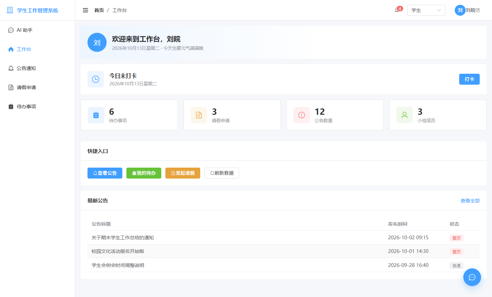
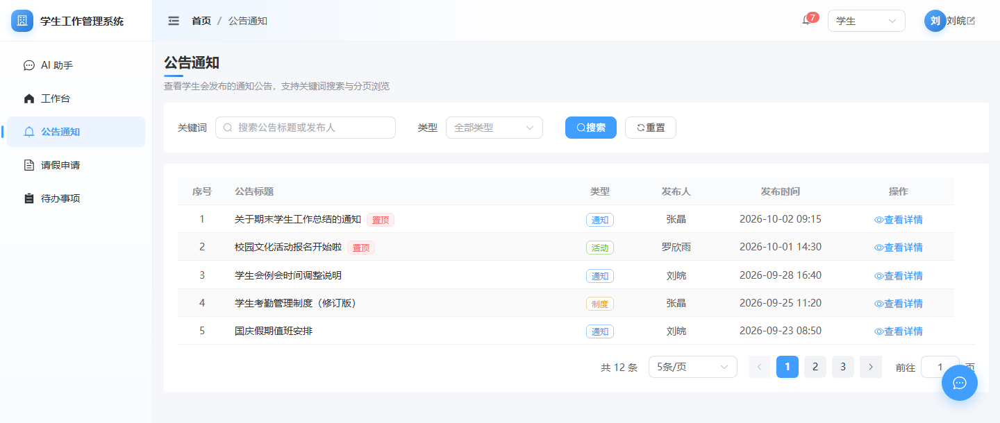
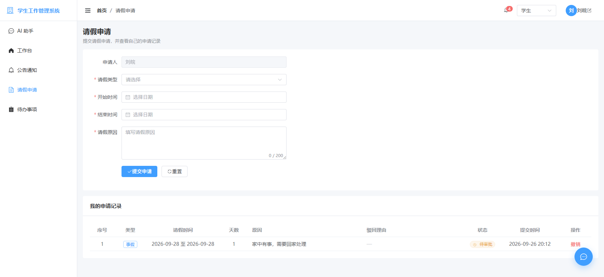
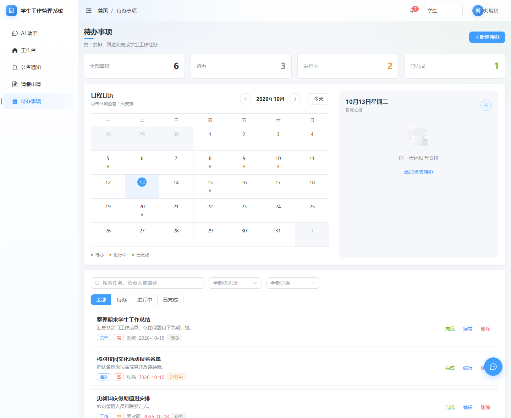
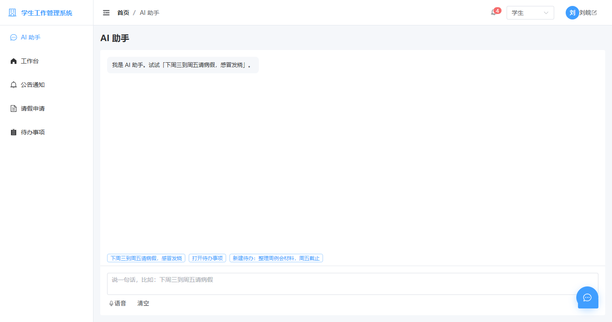
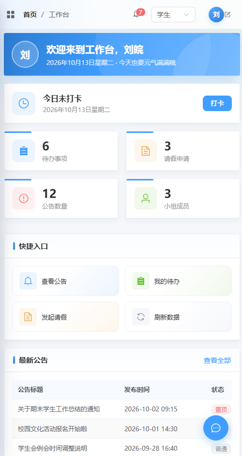
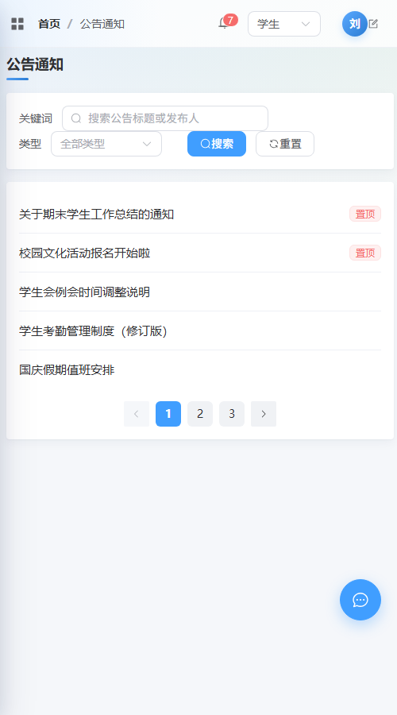

# 学生工作管理系统

> 大学生小组作业 · Vue 3 + Vite + Element Plus 前端项目

## 一、项目简介

面向学生会的日常事务管理前端系统，包含工作台总览、公告通知浏览、请假申请、待办事项四大模块。
本项目为**纯前端实现**，数据当前使用本地假数据（mock），接口层预留完毕，后端就绪后可直接替换。

### 🤖 AI 助手（2026-10-12 新增）

右下角悬浮唤出聊天窗，用一句中文就能把表单填好（悬浮球可以拖着换位置，松手吸附到边缘）：

| 你说 | 它干什么 |
| --- | --- |
| `下周三到周五请病假，感冒发烧` | 自动填好请假表单（只填，不提交） |
| `今天到后天事假，回家办事` | 事假 + 日期 + 原因，一次填好 |
| `新建待办：整理周例会材料，周五截止` | 打开新建弹窗并预填 |
| `打开待办事项` | 跳转页面 |
| `帮我打卡` | 自动去工作台把今天的卡打上（用你的定位） |
| `把整理工作总结标成完成` / `删掉它` | 直接改待办状态（删除会先确认） |
| `撤销我的请假申请` | 撤掉还没审批的那条申请（会先确认） |
| `通过张晶的请假`（管理员） | 走审批（通过要确认、驳回要填理由，最后一步都是人点） |
| `看看奖学金那条公告` | 搜出来并直接打开详情 |
| `切到管理员` / `以后叫我小王` / `把动效关掉` | 切身份 / 改名 / 开关界面设置 |
| `我有哪些待办` | 把待办念出来（含“已遍期”提醒） |
| `我的请假批了吗` | 报请假记录的状态 |
| `最近有什么公告` | 念最新的几条公告 |

左下角还有个 **🎤 按住说话**——按住按钮说话、松手就停，识别出来的文字先落到输入框，你再自己点发送
（**只有 Chrome / Edge 有**，需要联网；Safari 和 Firefox 没有这个能力，手机上也建议改用电脑演示，见 `docs/AI智能体接入指南.md` 6.4）。

技术上是「工具调用」式智能体：模型只负责听懂和决策，真正动手的是后端白名单校验过的代码。
十五个工具：十一个动手（跳页 / 填请假 / 建待办 / 打卡 / 完成待办 / 撤销请假 / 审批 / 搜公告 / 切身份 / 改名 / 设置开关）+ 三个查数据（待办 / 公告 / 请假），
后面的只读工具让 AI 从「会填表」变成「知道事」。
模型跑在**你自己电脑上**（Ollama + `qwen2.5:7b`），不用联网、不用 API key、不花钱。

模型或代理挂掉时会自动降级：**本机模型 → 后端正则规则 → 前端兜底**，演示现场不会哑火。

> 📘 **接入文档**：[docs/AI智能体接入指南.md](docs/AI智能体接入指南.md) —— 架构、契约、怎么加新工具、踩过的坑。
> 📘 **架构文档**：[docs/项目框架.md](docs/项目框架.md) —— 目录职责、数据流、分工边界。

**响应式**：适配到手机。屏幕窄于 768px 时侧边栏自动变成抽屉，统计卡片改为一行两张，
页头改竖排，弹窗占满宽度，页头那句说明文字直接隐藏（一屏就那么高，标题够了）。
只用断点变量和媒体查询做的，没引任何 UI 框架。

**公告页在手机上只列标题** —— 六列表格在 390px 宽下要横向滚，序号 / 发布人 / 发布时间挤成一团，
而这些信息详情弹窗里都有。所以窄屏只留「叫什么」，点标题看详情；分页也只留翻页按钮。
判断用 `src/composables/useMediaQuery.js`（和 CSS 断点共用一个常量）。

**交互细节**：

- **AI 助手悬浮球可以拖着挪位置** —— 松手会吸附到最近的左右边缘（停在中间会挡内容），
  垂直高度按你拖到的地方保留，刷新也记得（存 localStorage）。抽屉从哪边弹出来跟着按钮走。
- **待办事项左滑露出操作** —— 手机上往左划一下就是「完成 / 编辑 / 删除」，
  不用再去够右边那排小按钮；同时只会打开一行，点行内容或点完操作都会自己收回去。
  **大屏不滑**：屏幕宽的时候按钮直接排在行右边（滑动是触屏手势，鼠标划反而别扭，
  而且大屏本来就有地方）。这个切换由 `SwipeRow` 的 `disabled` 属性控制。
- **侧边栏底部是账号入口** —— 头像 + 名字点一下弹出「我的 / 设置 / 退出账户」：
  「我的」改显示名称和看身份，「设置」两个开关（界面动效 / 未读红点，都真能生效），
  「退出账户」带二次确认（本地演示没有登录，所以「退出」= 把本地身份恢复默认）。

## 二、小组成员及分工

| 成员 | 角色 | 负责内容 | 开发分支 | 负责文件 |
| --- | --- | --- | --- | --- |
| 刘皖 | 前端核心开发 / 技术规范 / 仓库管理 | 项目初始化、路由与整体布局、全局样式规范、工作台首页、公告通知页、GitHub 仓库维护与代码合并 | `main` | `router/`、`layout/`、`views/dashboard/`、`views/notice/` |
| 罗欣雨 | 请假模块开发 / 答辩主讲 | 请假申请页面、答辩 PPT 与演示讲解 | `feature/luo-xinyu` | `views/leave/` |
| 张晶 | 待办模块开发 / 项目统筹 | 待办事项页面、进度统筹与最终整合 | `feature/zhang-jing` | `views/todo/` |

## 三、技术栈

| 技术 | 版本 | 说明 |
| --- | --- | --- |
| Vue | 3.x | 组合式 API（`<script setup>`） |
| Vite | 8.x | 构建工具，秒级热更新 |
| Vue Router | 5.x | 前端路由，history 模式 |
| Element Plus | 2.x | UI 组件库（全量引入 + 中文语言包） |
| Prettier | 3.x | 代码格式化，全组统一风格 |

## 四、页面结构

```
/
├── /dashboard   工作台首页（打卡 + 数据卡片 + 快捷入口 + 最新公告）
├── /notice      公告通知（搜索 + 筛选 + 分页 + 详情弹窗）
├── /leave       请假申请（罗欣雨）
├── /todo        待办事项（张晶）
├── /assistant   AI 助手（刘皖）
└── /:pathMatch  404 页面
```

## 五、如何运行项目

前置条件：已安装 Node.js（建议 20 及以上）。

```bash
# 1. 克隆仓库
git clone https://github.com/stttop23/zuoye.git

# 2. 进入目录
cd zuoye

# 3. 安装依赖（第一次运行必须执行，约 1-3 分钟）
npm install

# 4. 启动开发服务器
npm run dev
```

浏览器打开终端中显示的地址（默认 <http://localhost:5173>）即可看到页面。

### 想给别人看（不部署也够用）

**方案一：同一局域网，手机 / 队友直接打开 —— 顺便演示移动端**

`npm run dev` 起来后，终端里除了 `Local` 还会有一行 `Network: http://192.168.x.x:5173/`
（`vite.config.js` 里已经配好 `server.host: true`，**不用加任何参数**）。
把那行地址发到手机上，**连同一个 WiFi 就能直接打开**，
会自动切成抽屉侧边栏、公告页变标题列表那一套 —— 就是第八节那两张手机截图的状态。

**方案二：跑「打包之后的真实产物」**

```bash
npm run build     # 打包到 dist/
npm run preview   # 起服务跑 dist/，默认 http://localhost:4173/
```

`dev` 是开发模式（带热更新），`preview` 跑的是 `dist/` 里的真产物。
答辩前跑一遍，能提前发现「只有打包后才暴露」的问题。

实测：**`preview` 同样代理 `/api`**（Vite 的 preview 服务会沿用 `server.proxy`），
所以只要 Flask（`python server/app.py`）和 Ollama 开着，
**`preview` 下 AI 也是完整的**，不会降级。

> 演示建议：常规用 `npm run dev`（临时要改代码不用重新构建）；
> 想更接近「真上线」的观感或看性能，就用 `npm run preview`。
>
> ⛔ **本项目不做线上部署** —— 模型跑在本机，挂上去 AI 会降级成本地正则规则；
> 打卡定位还必须有 https，用 http 的 IP 直访浏览器直接拒绝给位置。演示效果反而更差。

其他命令：

```bash
npm run format        # 格式化四个目录下的代码（src / liuwan / luoxinyu / zhangjing）
npm run format:check  # 只检查不修改，提交前跑一下，看谁把格式写乱了
```

## 六、团队开发规范

### 1. 分支规范

- `main` 分支为**稳定分支**，禁止直接提交业务代码。
- 两个队友分支 `feature/luo-xinyu`、`feature/zhang-jing` **已由仓库管理员建好并推送**，队友直接切换过去即可，不需要自己创建：

```bash
git clone https://github.com/stttop23/zuoye.git
cd zuoye
git checkout feature/luo-xinyu      # 换成你自己的分支名
npm install
npm run dev
```

- 功能完成后在 GitHub 发起 Pull Request，由仓库管理员审核合并。
- 分支名统一使用拼音而非中文，避免 Windows 中文终端下出现乱码分支。

### 2. 代码规范

- **样式颜色禁止写死**，必须使用 `src/assets/styles/variables.css` 中的 CSS 变量：

```css
/* ✅ 正确 */
color: var(--st-text-primary);

/* ❌ 错误 */
color: #303133;
```

- 组件优先使用 Element Plus 现成组件，不要手写重复的表格 / 弹窗。
- **页面不要自己内联业务数据，统一用 `src/composables/appStore.js`。**
  那个文件是全站待办 / 公告 / 请假 / 打卡的【唯一运行时源头】：初始值从 `src/mock/index.js` 取，
  后面自动写 localStorage（刷新不丢）。页面 import 它的 ref 用就行。
  以前首页写「公告 3 条」、公告页实际 12 条，就是因为各处各写一份。
  数字一律从 appStore 算出来，不要手写。
- **AI 只读工具读的也是同一份数据**：前端每次发消息都把当前数据带上
  （`appStore.js` 的 `agentSnapshot()`），后端优先用它。
  否则会出现「你在页面上填了 / 删了，AI 说的还是老样子」——
  这种对不上比单纯答错更伤，因为听着有据可查。
- 页面专属样式写在对应 `.vue` 文件的 `<style scoped>` 中，不要污染全局样式。
- 提交前保存文件会自动格式化（VS Code 已配置 Prettier），也可以手动执行 `npm run format`。
  想检查有没有漏掉的，跑 `npm run format:check`（覆盖 `src/` 和三个成员目录）。
  > ⚠️ 以前的 `format` 脚本只写了 `src/**`，**队友那三个文件夹根本不会被格式化**，已修。

### 3. 动效与设计规范

界面升级过一次，动效全部走变量，**不要在自己页面里各写一个 `0.3s`**。
节奏不统一的界面，看起来比完全不动还乱。

| 想做什么 | 用什么 |
| --- | --- |
| 颜色 / 圆角 / 阴影 / 间距 | `variables.css` 里的 `--st-*` 变量（新增了渐变、光晕、四层阴影、动效时长） |
| 区块淡入上移 | 加 class `st-fade-up` |
| 整块淡入（不带位移） | 加 class `st-fade-in` |
| 一排卡片挨个出现 | 再加 `st-delay-1` ~ `st-delay-6`（错峰，别一次全冒出来） |
| 图标 / 徽标「弹」出来 | `st-pop` |
| 数字从 0 滚上来 | `<CountUp :value="6" />`（`src/components/CountUp.vue`） |
| 列表项左滑露出操作 | `<SwipeRow>`（`src/components/SwipeRow.vue`）；大屏传 `:disabled` 就变成「按钮直接排在右边」 |
| 窄屏字号 | 全局在 `@media (max-width: 768px)` 里统一压一档：大数字 24→20、欢迎条 20→17、区块标题 16→15、日历格子 68→56px。**正文保持 13-14px 不动**（再小就该眯眼了） |
| 界面文案 | **能删就删**：不写页面副标题、不在按钮旁写解释、不写「点击这里查看详情」这类引导语、不在图标上挂「（可以拖）」这种提示。标题 + 图标能说清就别加字。 |
| 悬停抬升 | `transform: translateY(-4px)` + `--st-shadow-hover` |
| 缓动曲线 | `--st-ease`（标准）/ `--st-ease-back`（带一点回弹） |

> ⚠️ **在全局 CSS 里覆盖各页面自己的 scoped 样式，必须写三层选择器**：
> 页面里写的是 `.page-title`，scoped 编译成 `.page-title[data-v-xxx]`（权重 0,2,0），
> 我写 `.page-title`（0,1,0）**压不住**，得写 `.layout .layout__main .page-title`（0,3,0）。
> 窄屏那几条字号规则就是靠这个才生效的。

> ⚠️ **别漏了 `prefers-reduced-motion`。** 全局已兜底（动画时长归零），
> 但你自己写的 `animation-delay` 也要一起清零，否则开了「减少动态效果」的人
> 反而会看到一段空白。这个坑我们踩过，见 `global.css` 里的注释。
> 自己用 JS 写动画（比如数字滚动）时，也要判断一下：
> `window.matchMedia('(prefers-reduced-motion: reduce)').matches`。

### 4. 提交信息规范

| 前缀 | 含义 |
| --- | --- |
| `feat:` | 新增功能 |
| `fix:` | 修复问题 |
| `style:` | 样式调整 |
| `docs:` | 文档修改 |
| `refactor:` | 重构 |

示例：`feat: 完成公告通知页面分页功能`

### 5. 每日工作流

```bash
git pull origin main              # ① 开工前先同步别人的代码
# ...写代码...
git add .
git commit -m "feat: 完成待办列表"
git push                          # ② 收工前推送到远程
```

### 6. 注意事项

- **不要删除也不要提交 `node_modules`**（已在 `.gitignore` 中忽略）。
- 打开项目后，VS Code 会提示安装推荐插件（Volar、Prettier），请务必安装。
- 遇到报错先复制红色报错信息搜索，90% 是拼写错误或漏装依赖。

## 七、目录结构

```
zuoye/
├── liuwan/                     ★ 刘皖负责的页面
│   └── views/
│       ├── dashboard/          工作台首页
│       │   ├── index.vue         页面主体：欢迎条 + 组装子组件
│       │   └── components/       CheckIn / StatCards / QuickActions / RecentNotices
│       ├── notice/             公告通知
│       │   ├── index.vue         页面主体：页头 + 组装子组件
│       │   └── components/       NoticeFilter / NoticeTable / NoticeDetailDialog
│       ├── assistant/          AI 助手独立页面
│       │   └── index.vue         复用 src/components/AiChatPanel.vue
│       └── NotFoundView.vue    404 页面
├── luoxinyu/                   ★ 罗欣雨负责的页面
│   └── views/leave/
│       ├── index.vue             请假申请：组装子组件 + 假数据
│       └── components/           LeaveForm（表单+校验）/ LeaveRecords（记录表）
├── zhangjing/                  ★ 张晶负责的页面
│   └── views/todo/
│       ├── index.vue             待办事项：表格 + 分页 + 组装子组件
│       └── components/           TodoStats / TodoToolbar / TodoDialog
├── src/                        应用外壳（三个页面共用，不属于某个人）
│   ├── api/
│   │   ├── ai.js               AI 助手接口层（只认前后端约定的 JSON 契约）
│   │   └── geo.js              地理位置接口层（坐标→地名）
│   ├── assets/styles/
│   │   ├── variables.css       全局颜色 / 间距变量（全组统一，禁止写死色值）
│   │   └── global.css          全局基础样式
│   ├── components/
│   │   ├── AiAssistant.vue     右下角悬浮球（可拖动 + 吸附）+ 抽屉壳
│   │   ├── AiChatPanel.vue     AI 聊天本体（抽屉和独立页面共用）
│   │   ├── CountUp.vue         数字滚动（从 0 滚到目标值）
│   │   └── SwipeRow.vue        左滑露出操作（待办列表在用，通用组件）
│   ├── composables/
│   │   ├── appStore.js         ★ 全站业务数据的【唯一运行时源头】（待办/公告/请假/打卡，localStorage 持久化）
│   │   ├── aiAgent.js          AI 对话状态 + 填表/命令动作总线 + 本地兜底
│   │   ├── useSpeechInput.js   语音输入（浏览器 Web Speech API 封装）
│   │   ├── notifications.js    顶栏通知中心（从 appStore 的实时数据推出来 + 已读状态）
│   │   ├── permissions.js      权限能力表（前端控制，真正拦人靠后端）
│   │   ├── uiSettings.js       界面偏好（界面动效 / 未读红点，localStorage 持久化）
│   │   └── userProfile.js      当前用户显示名称 + 角色（localStorage 持久化）
│   ├── layout/
│   │   └── BasicLayout.vue     整体布局：侧边栏（含底部账号入口）+ 顶栏（含通知中心）+ 面包屑 + 内容区
│   ├── mock/
│   │   └── index.js            初始种子数据（只被 appStore 读一次，页面不再直接用它）
│   ├── router/
│   │   └── index.js            路由表（刘皖统一维护）
│   ├── App.vue
│   └── main.js                 入口：Element Plus、路由、全局样式
├── server/                     AI 代理服务（Flask，调本机模型）
│   ├── app.py                  工具定义 + 智能体循环 + 日期校正 + 本地规则兜底
│   ├── mock_data.py            兜底种子（拿不到前端快照时才用；接数据库后删）
│   ├── requirements.txt
│   ├── .env                    本机配置（已被 gitignore，不提交）
│   └── .env.example            配置模板
├── deploy/
│   └── nginx-zuoye.conf        ⛔ 暂不用（部署留档，含 SPA 路由坑与 HTTPS 配置）
├── docs/
│   ├── screenshots/            页面截图（README 第八节在用）
│   ├── 项目框架.md             架构与分工说明
│   ├── AI智能体接入指南.md     AI 助手：架构、契约、扩展、踩坑
│   └── AI填表方案.md           动手前的方案稿（存档）
├── .prettierrc.json            格式化规则
├── index.html
├── vite.config.js
└── package.json
```

> **拆分约定**：每个页面都是一个文件夹，`index.vue` 只做「组装」，
> 具体的表格、表单、弹窗放到同级的 `components/` 里。
> 改一个页面不会碰到别人的代码。
>
> 文件夹名用**拼音**（`liuwan` / `luoxinyu` / `zhangjing`）而不是中文，
> 和分支命名一个道理：中文路径在 Windows 终端里会显示成乱码。

## 八、项目截图

> 图片在 `docs/screenshots/`，1440 宽，点开可看大图。

**工作台** —— 欢迎条 + 每日打卡（带定位）+ 数据卡片 + 快捷入口 + 最新公告



**公告通知** —— 搜索 + 类型筛选 + 分页 + 详情弹窗



**请假申请** —— 表单校验 + 日期联动 + 合计天数 + 申请记录



**待办事项** —— 统计 + 日程日历 + 筛选 + 表格



**AI 助手** —— 独立页面，和右下角悬浮窗共用同一份对话



**手机端** —— 侧边栏变成从左侧滑出的抽屉（点汉堡按钮开，点遮罩 / 按 Esc / 跳页面都会自动收起）



**手机端 · 公告通知** —— 窄屏只列标题，点标题看详情



## 九、开发进度

- [x] 项目初始化与依赖配置
- [x] 整体布局与路由框架
- [x] 全局样式变量与代码规范
- [x] 工作台首页（刘皖）
- [x] 公告通知页面（刘皖）
- [x] 按成员划分独立模块文件夹
- [x] 队友开发分支创建（`feature/luo-xinyu`、`feature/zhang-jing`）
- [x] 请假申请页面（罗欣雨）
- [x] 待办事项页面（张晶）
- [x] 自定义用户显示名称（张晶）
- [x] 按人重组目录 + 页面拆分子组件
- [x] AI 助手：询问 / 跳转 / 自然语言填表（刘皖）
- [x] AI 助手独立页面（侧边栏入口，与悬浮抽屉共享同一份对话）
- [x] AI 助手语音输入（浏览器 Web Speech API，**仅 Chrome / Edge**，需联网且需安全环境）
- [x] 本机模型接入（Ollama + qwen2.5:7b，离线可用、不需要 key）
- [x] AI 助手降级方案（本机模型 → 本地规则 → 前端兜底）
- [x] AI 助手只读工具（查待办 / 查公告 / 查请假）
- [x] 工作台每日打卡（带地理位置）
- [x] 打卡地点显示地名（高德逆地理编码，需在 `server/.env` 填 `AMAP_KEY`）
- [x] 顶栏通知中心（未读红点 + 已读状态）
- [x] 假数据统一到 appStore（唯一运行时源头；页面里再没有内联的假数据了）
- [x] 数据和 AI 同源（发消息时把页面数据当快照推给后端，AI 说的和页面看到的不再打架）
- [x] 刷新不丢（appStore 自动写 localStorage；新建的待办 / 请假刷新还在）
- [x] 发布公告（真发得出去：公告页、首页数字、最新公告、通知中心一起变）
- [x] 通知中心改为从实时数据推导（审批 / 提交后铃铛真的会亮）
- [x] AI 能答「我今天打卡了吗」（`checkin_status` 只读工具）
- [x] 权限补全（待办只能删自己的；管理员不能审批自己的申请）
- [x] 五个页面的截图（`docs/screenshots/`）
- [x] 权限能力表（`src/composables/permissions.js`，公告页的「发布公告」按角色显示）
- [x] 界面动效升级（胶囊菜单、页面过渡、数字滚动、无障碍适配）
- [x] 移动端适配（窄屏侧边栏变抽屉，断点 768px）
- [x] AI 悬浮球可拖动 + 边缘吸附（位置记在 localStorage）
- [x] 待办事项左滑操作（大屏改为按钮直排；抽出 `src/components/SwipeRow.vue`）
- [x] 公告页手机版只显示标题（断点判断抽成 `src/composables/useMediaQuery.js`）
- ⛔ **不部署到线上服务器**（2026-10-13 决定）：模型跑在本机，挂上去 AI 会降级成本地规则、
  打卡定位还必须有 https，演示效果反而比本机差。**演示就用本机 `npm run dev`。**
  唯一留下的部署存档是 `deploy/nginx-zuoye.conf`（含 SPA 路由坑 + HTTPS 写法）
- [ ] 后端接口对接
- [ ] 把假数据换成数据库（改 `src/composables/appStore.js` 里读写 localStorage 的部分，页面不用动；
  然后把 `server/mock_data.py` 删掉，只读工具改成查库）
