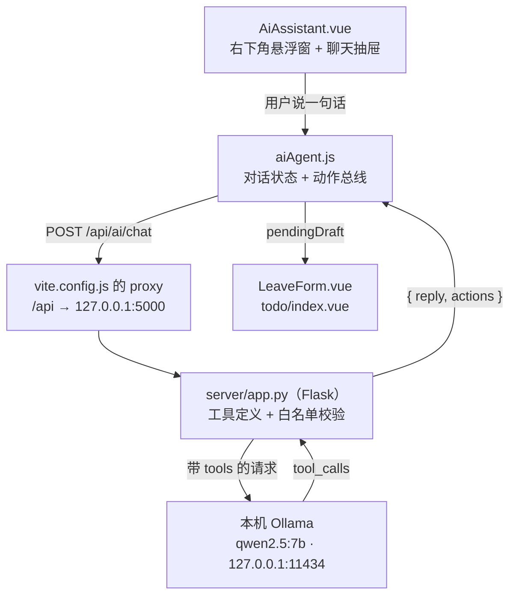

# AI 智能体接入指南

> 项目：学生工作管理系统（Vue 3 + Vite + Element Plus）
> 完成时间：2026-10-12 · 负责人：刘皖
> 一句话：**右下角一个蓝色圆按钮，说人话就能查东西、跳页面、把表单填好。**
> 模型跑在**你自己电脑上**（Ollama + qwen2.5:7b），不用联网、不用 API key、不花钱。

---

## 一、它到底是什么

### 1.1 聊天机器人和智能体的区别

| | 聊天机器人 | 智能体（本项目） |
| --- | --- | --- |
| 你说「帮我请个假」 | 回你「好的，请到请假页填写」 | 自己把表单填好，再说「填好了，你看一眼」 |
| 能力来源 | 只有一张嘴 | 一张嘴 + 一双手 |

差的这一双手，在技术上叫 **工具（tools）**。我们交给模型一张能力清单：

```
┌────────────────────────────────────────────────┐
│ 【动手】                                        │
│ go_to_page       → 跳转到指定页面                │
│ fill_leave_form  → 把请假信息填进请假表单        │
│ create_todo      → 打开新建待办弹窗并预填        │
│ check_in         → 帮用户打卡（用浏览器定位）    │
│ undo_check_in    → 撤销今天的打卡                │
│ manage_todo      → 完成 / 重新打开 / 删除 / 编辑 │
│ cancel_leave     → 撤销自己还没审批的请假        │
│ review_leave     → 审批请假（仅管理员）        │
│ open_notice      → 搜一条公告并打开详情          │
│ switch_role      → 切换学生 / 管理员              │
│ rename_user      → 改显示名称                    │
│ toggle_setting   → 开关界面动效 / 未读红点        │
│ 【只读】                                        │
│ list_todos / list_notices / list_leave_records   │
│ checkin_status   → 查今天打没打卡              │
└────────────────────────────────────────────────┘
      ↑ 模型自己决定用哪个、传什么参数
      ↓ 我们（后端代码）负责真正执行
```

> ⚠️ 工具从 7 个涨到 16 个之后，小模型明显开始选错（实测把「打开待办事项」
> 理解成「念一遍待办列表」）。应对办法不是继续改提示词，而是**把确定性的事写死**：
> `enforce_navigation` 强制「打开 X 页面」只走跳转；`sanitize` + `enforce_commands`
> 在模型「只说不做」时用本地规则把动作补上。详见 `server/app.py` 里的注释。
>
> 只读工具类也同理：「我今天打卡了吗」是问情况、不是命令，
> 所以走 `checkin_status`；本地兜底 `local_parse` 也直接读快照如实回答，
> 不会因为后端连不上就装不知道。

### 1.2 最重要的安全底线

> **模型只出主意，动手的永远是被我们审查过的代码。**

模型**碰不到页面**。它只会返回一句「我要调用 `fill_leave_form`，参数是这些」，
真正去填表的是我们自己的 `runActions()`。所以：

- 模型不可能填错框、不可能覆盖用户刚打的内容
- 返回的字段要过**白名单**（契约里没写的字段一律丢弃）
- 日期要做**格式校验**，非法值直接扔掉
- 只填表，**永远不替用户点提交**

---

## 二、架构



| 层 | 文件 | 只干一件事 |
| --- | --- | --- |
| 界面层 | `src/components/AiAssistant.vue` | 画气泡、收输入、开关抽屉 |
| 状态层 | `src/composables/aiAgent.js` | 存对话、执行动作、最后一道兜底 |
| 接口层 | `src/api/ai.js` | 按契约发请求（换后端只改这里） |
| 代理层 | `server/app.py` | 定义工具、校验参数、跑智能体循环 |
| 页面层 | `LeaveForm.vue`、`todo/index.vue` | 接到草稿就填进表单 |

### 模型就在本机，为什么还留一个代理层？

因为它的价值早就不只是「藏 key」了：

1. **契约收口** —— 前端只认 `{ reply, actions }`。以后想换模型、甚至换成云端模型，
   只改这一层，前端一行都不用动。
2. **白名单校验** —— 模型给什么不算数，这一层逐字段检查过，才允许落到表单上。
3. **降级** —— 本机模型没启动 / 报错时，这里还能退回本地正则规则。

---

## 三、文件清单

### 3.1 新增（全部归刘皖）

| 文件 | 说明 |
| --- | --- |
| `server/app.py` | Flask 代理：工具定义、智能体循环、参数清洗、日期校正、本地规则兜底 |
| `server/requirements.txt` | Flask / requests / python-dotenv |
| `server/.env.example` | 配置模板（**会提交**） |
| `server/.env` | 本机配置（**被 gitignore，不提交**） |
| `src/api/ai.js` | 接口封装，只认契约 |
| `src/api/geo.js` | 地理位置接口层（坐标→地名，拿不到就返 null，见 13.3） |
| `src/composables/aiAgent.js` | 对话状态、`pendingDraft` 动作总线、前端兜底、日期解析 |
| `src/composables/useSpeechInput.js` | 语音输入（浏览器 Web Speech API 的封装） |
| `src/components/AiAssistant.vue` | 右下角悬浮入口（只有悬浮按钮 + 抽屉壳） |
| `src/components/AiChatPanel.vue` | **聊天的本体**（消息列表 + 输入区 + 语音），抽屉和独立页面共用 |
| `server/mock_data.py` | 兜底种子数据（只在拿不到前端快照时才用，接了数据库就删） |
| `src/composables/appStore.js` | 全站业务数据的唯一源头 + `agentSnapshot()`（发给 AI 的现场快照） |
| `src/composables/notifications.js` | 顶栏通知中心：通知列表 + 未读数 + 已读状态（见第十四节） |
| `liuwan/views/dashboard/components/CheckIn.vue` | 每日打卡，带地理位置（见第十三节） |
| `liuwan/views/assistant/index.vue` | AI 助手独立页面 |
| `.env.example`（根目录） | 线上代理地址占位（`VITE_AI_BASE_URL`） |
| `docs/AI智能体接入指南.md` | 本文件 |

### 3.2 改动

| 文件 | 改了什么 |
| --- | --- |
| `vite.config.js` | 加 `proxy: { '/api': 'http://127.0.0.1:5000' }` |
| `src/router/index.js` | 加一条 `/assistant` 路由 |
| `src/layout/BasicLayout.vue` | 挂了一个 `<AiAssistant />`（全站常驻） |
| `luoxinyu/views/leave/components/LeaveForm.vue` | +3 行 `watch(pendingDraft)` |
| `zhangjing/views/todo/index.vue` | +3 行 `watch(pendingDraft)` |

> ⚠️ **规矩提醒**：后两个文件属于队友（罗欣雨 / 张晶）。
> 按 `docs/项目框架.md` 的约定，只有她们自己能改。
> AI 功能合并进 `main` 之前应当在群里说一声、由她们自己加。
> 改动确实只有 3 行，但"小事所以自己动手"正是规矩最容易烂掉的地方。

---

## 四、怎么跑起来

### 4.1 三步

```powershell
# 第 1 步：装 Ollama（只需一次）
#   官网下载地址会跳 GitHub，国内直连会断。用镜像下，然后务必验签名：
#   Get-AuthenticodeSignature 应显示 Valid + CN=Ollama Inc.
#   安装时指定目录，别占 C 盘：OllamaSetup.exe /DIR="E:\ollama"

# 第 2 步：拉模型（只需一次，4.36 GB）
#   直连 registry.ollama.ai 会 Error: unexpected EOF，改从魔搭下 GGUF 再导入（见 7.1）

# 第 3 步：开两个终端
python server/app.py     # 终端 1：AI 代理
npm run dev              # 终端 2：前端
```

打开 <http://localhost:5173>，右下角出现蓝色圆按钮。

### 4.2 确认模型在跑

```powershell
ollama list                                    # 应能看到 qwen2.5:7b
Invoke-RestMethod http://127.0.0.1:5000/api/ai/health
# → {"ok":true,"providers":["本机 qwen2.5:7b"]}
```

`providers` 里没有东西 = 模型被关掉了（`OLLAMA_ENABLED=0`），此时只剩本地正则规则。

### 4.3 不需要任何 API key

这一点和大多数教程不一样：**模型跑在你自己的电脑上，没有 key 这种东西**。
不联网、不注册、不花钱，只花电费。

> 所以 `server/.env` 里**没有密钥**，它只是用来调参数的（换模型、改超时、开关模型）。

---

## 五、接口契约（前后端唯一的约定）

契约不变，换模型 / 换后端语言 / 换服务器，前端一行都不用改。

### 请求

```
POST /api/ai/chat
Content-Type: application/json

{
  "messages": [ { "role": "user", "content": "下周三到周五请病假，感冒发烧" } ],
  "page": "/leave",       // 用户当前所在页面，帮模型判断上下文
  "user": "刘皖"          // 当前显示名称
}
```

### 响应

```json
{
  "ok": true,
  "source": "ollama",                // ollama = 本机模型；local = 本地规则兜底
  "reply": "请假信息已填写，请您确认后再提交。",
  "actions": [
    { "type": "fill", "target": "leave",
      "fields": { "type": "病假", "startTime": "2026-10-21", "endTime": "2026-10-23", "reason": "感冒发烧" } }
  ]
}
```

### actions 一共就三种

| action | 含义 | 前端怎么处理 |
| --- | --- | --- |
| `{ type: 'navigate', path }` | 跳页面 | `router.push(path)` |
| `{ type: 'fill', target: 'leave', fields }` | 填请假表单 | 写进 `pendingDraft`，`LeaveForm.vue` 接住 |
| `{ type: 'fill', target: 'todo', fields }` | 预填新建待办弹窗 | 写进 `pendingDraft`，`todo/index.vue` 接住 |

> **只读工具不产生 action**。`list_todos` / `list_notices` / `list_leave_records` /
> `checkin_status` 是「取数据给模型看」，前端什么都不用做 —— 所以它们的结果不会出现在
> `actions` 里。原因和做法见第十五节。

### 字段白名单

**leave**：`type`（事假/病假/年假）、`startTime`、`endTime`（`YYYY-MM-DD`）、`reason`（5–200 字）

**todo**：`title`、`description`、`category`、`priority`、`assignee`、`dueDate`、`status`

> 后端 `clean_leave()` / `clean_todo()` 会**逐个字段校验**，不在白名单或格式不对的直接丢掉。
> **模型说什么不算数，代码认了才算数。**

---

## 六、怎么用

### 6.1 三种输入方式

**打字** / 点**快捷短语** / **说话**（见 6.4）

### 6.2 试用这几句

| 你说 | 预期结果 |
| --- | --- |
| `下周三到周五请病假，感冒发烧` | 抽屉自动收起，请假表单填好，等你点提交 |
| `今天到后天事假，回家办事` | 事假、今天到后天、原因「回家办事」 |
| `打开待办事项` | 跳到 `/todo` |
| `新建待办：整理周例会材料，周五截止` | 待办新建弹窗打开，标题 + 截止日期都预填 |

### 6.3 气泡下面那行小字

**`本机模型`** = 模型答的，**`本地规则`** = 死规则答的。

### 6.4 语音输入

**按住**输入框左下角的「🎤 按住说话」开始说话，**松手就停**（跟微信语音一个手感）。

| 步骤 | 界面表现 |
| --- | --- |
| 按住按钮 | 按钮变红「松开停止」、麦克风图标呼吸闪烁、输入框提示变「正在听……」 |
| 说话时 | 文字**实时**出现在输入框（会先出现临时结果，还在变） |
| 松手 | 按钮变回「按住说话」，已经识别出来的文字**留在输入框里** |
| 点「发送」 | 和其它输入方式完全一样 |

> 为什么是「按住」而不是「点一下开关」：说话要持续几秒，点一下的开关很难用。
> 松手可能发生在按钮外面（手指滑出去），所以监听挂在 `window` 的 `pointerup / pointercancel` 上，
> **手滑出按钮也能正常停**。同时在手机上把系统的长按选择菜单挡掉了
> （`touch-action: none` + `user-select: none` + `@contextmenu.prevent`），否则长按会被系统打断。
> 键盘也能用：**按住空格**开始、松开停止。

**⚠️ 四条必须知道的限制（答辩时别讲错）：**

| 限制 | 说明 |
| --- | --- |
| **只有 Chrome / Edge 有** | MDN 兼容性表：Chrome ✅ Edge ✅ Firefox ❌ **Safari ❌**。<br>→ **iPhone / iPad 上任何浏览器都用不了**（iOS 上全是 Safari 内核），这不是配置问题，开 HTTPS 也救不了。不支持时按钮自动置灰，悬停有提示 |
| **必须联网** | 它**不是本机识别**——音频会发到浏览器厂商的服务器（Edge→微软，Chrome→Google）。所以它和「模型跑在本机、数据不出机器」是**两回事** |
| **必须安全环境** | `localhost` 和 `https` 算，**`http://192.168.x.x` 这类局域网 IP 不算**。所以电脑上（localhost）好用、手机上用局域网 IP 打开可能直接被拒 |
| 手机上会断 | Chrome for Android 的识别会被静音 / 烬屏打断；而且**麦克风不是马上释放的**，旧会话刚结束就 `start()` 会报 `audio-capture`（用户看到「录音被占用」）。所以续听必须**隔 400ms**，且失败要允许重试（最多 3 次）—— 这个坑是安卓真机实测出来的 |

> **结论：语音只适合在电脑上演示**（`localhost` 是安全环境 + 是 Chrome/Edge）。
> 手机上建议只演示打卡定位（不需要语音）。
> 真机演示时，用 `F12 → Ctrl+Shift+M` 的手机模式在电脑上演语音，效果一样而且不依赖网络。

想做到**真正离线**的语音识别，得另接本地 Whisper（下模型 + 写服务），那是另一套东西。
取舍说明写在 `src/composables/useSpeechInput.js` 顶部。

**设计上刻意没做的事**：识别完**不会自动发送**——文字先落到输入框，你看一眼、改一改，
再自己点发送。跟「AI 只代笔、不代签」是同一条原则。

---

### 6.5 填完会自动跳到对应页面

AI 填好表之后会**自动跳转到那个页面**并收起聊天窗，等你确认。

为什么要加这一步：以前不跳，用户停在别的页面上**什么都看不到**，
会以为「AI 什么都没干」。

| 你说 | 会发生什么 |
| --- | --- |
| 在【待办页】说「下周三到周五请病假」 | 自动跳到**请假页**，表单已填好 |
| 在【请假页】说「新建待办：…」 | 自动跳到**待办页**，新建弹窗已打开并预填 |

目标页面的对应关系写在 `aiAgent.js` 的 `FILL_TARGET_PAGES` 里。
对话里如果模型另外给了 `navigate`，同一页面只跳一次，不会跳两遍。

> ⚠️ 实现上有个坑，见第十节「坑 7」。

### 6.6 两个入口，同一份对话
同一个助手有两个入口：

| 入口 | 怎么进 | 适合 |
| --- | --- | --- |
| 右下角**悬浮抽屉** | 点右下角蓝色圆按钮 | 在别的页面上随手问一句 |
| 左侧菜单「**AI 助手**」 | 侧边栏点进去 | 专心聊、**答辩演示** |

两边**共用同一份对话**——在抽屉里聊到一半，切到页面记录还在（状态存在 `aiAgent.js` 里）。

它们共用同一个聊天组件 `src/components/AiChatPanel.vue`，所以行为完全一致：
同样的快捷短语、同样的语音输入、同样的「填完自动跳页」。

---

## 七、降级：模型挂了也不哑火

```
用户发一句话
   ↓
① 本机 Ollama（qwen2.5:7b）  → source: "ollama"  气泡下标「本机模型」
   ↓ 没启动 / 超时 / 报 500 / 参数残缺
② 后端本地正则规则            → source: "local"   下标记「本地规则」
   ↓ 后端整个没启动（连 Flask 都没跑）
③ 前端 aiAgent.js 再兜一层
```

每一层往下走都会在服务端打印一行 `[降级] xxx 用不了 → 原因`，排查时看终端就行。

**⚠️ 两个排查经验（都踩过）：**

1. **别用 `raise_for_status()`。** 它只给你一个干巴巴的 `500 Server Error`，服务端到底为什么
   拒绝完全看不到。实测时就是卡在这一步，改成把响应正文带出来之后，
   才一眼看到真正的原因是 `invalid tool call arguments: unexpected end of JSON input`。
2. **降级的原因要带出来。** `server/app.py` 会把失败原因塞进响应的 `error` 字段，
   前端虽然不显示，但抓一次请求就能看到全部。

**本地规则认什么：** `今天/明天/后天/大后天`、`周X`、`下周X`、`本周X`、`X月X日`、`X到Y`、
`三天/2天`、`2026-11-03`。认不出来就老实说「我没听出是哪几天」，**不猜、不编**。

### 7.1 本机模型（Ollama）怎么装的

| 项 | 值 |
| --- | --- |
| 程序位置 | `E:\ollama`（安装时加 `/DIR="E:\ollama"`，不占 C 盘） |
| 模型文件 | `E:\ollama\models`（4.36 GB） |
| 模型 | `qwen2.5:7b`（Q4_K_M，7.6B，`Capabilities: tools`） |
| 显卡 | RTX 5060 Laptop 8GB，`ollama ps` 显示 `100% GPU` |

**踩到的三个坑：**

1. **官方下载地址跳 GitHub，国内直连会断。** `ollama.com/download/OllamaSetup.exe` 会 307 跳到
   GitHub Releases，实测直连不通。走镜像 `gh-proxy.com` 才下得动。
   ⚠️ 走镜像**一定要验数字签名**（`Get-AuthenticodeSignature`，应显示 `Valid` + `Ollama Inc.`），
   否则等于在陌生网站装了个 exe。
2. **`ollama pull` 会 `Error: unexpected EOF`。** 直连 `registry.ollama.ai` 大约 2.7 MB/s，还断流。
   正解是从**魔搭 ModelScope** 下单文件 GGUF，再用 `ollama create` 导入（单文件！官方仓库的
   `-00001-of-00002` 分片版对 Ollama 不友好）：

   ```powershell
   # 下载（单文件版在 bartowski / second-state 这两个仓库里）
   curl.exe -L -o E:\ollama\gguf\model.gguf `
     "https://modelscope.cn/models/bartowski/Qwen2.5-7B-Instruct-GGUF/resolve/master/Qwen2.5-7B-Instruct-Q4_K_M.gguf"

   # Modelfile 里只写 FROM + PARAMETER，⚠️ 不要写 SYSTEM（会和后端下发的 system 打架）
   # FROM ./Qwen2.5-7B-Instruct-Q4_K_M.gguf

   cd E:\ollama\gguf; ollama create qwen2.5:7b -f Modelfile
   ```
3. **`OLLAMA_MODELS` 环境变量对 Windows 那个托盘程序不生效。** 模型还是落在了
   `C:\Users\<你>\.ollama\models`。Windows 版把配置放在内部数据库里，不是注册表也不是
   `config.json`。最后一个能用的解法是**目录联接**：

   ```powershell
   # 停掉 ollama → 把模型搬到 E 盘 → 在原位置建一个「传送门」
   New-Item -ItemType Junction -Path "$env:USERPROFILE\.ollama\models" -Target 'E:\ollama\models'
   ```

**本机模型的能力边界（实测，别抱幻想）：**

| 能做 | 做不好 |
| --- | --- |
| 听懂人话、判断请假类型、提炼原因 | **算日期**（「下周三」算成 10-18、10-19） |
| 调用工具（`Capabilities: tools` ✔） | 信息模糊时容易「硬填」而不是反问 |
| 热启动 1~2 秒、约 50 tok/s | 冷启动要从硬盘读 4.4 GB，第一次可能等 1~3 分钟 |

### 7.2 关键设计：日期不由模型算

因为小模型算日期不靠谱，而且**给它对照表也没用**（实测给了 ISO 对照表还是算成 10-19），
最后改成让**确定性的代码**管日期：

```
【模型管】听懂人话、判断类型、提炼原因
【代码管】算日期 —— resolve_dates() 是确定性的、有测试覆盖的
```

`server/app.py` 里的 `reconcile_dates()` 会在模型返回之后，用我们自己的解析结果
把日期**校正一遍**；我们解析不出来时才用模型的值（这样不会覆盖「模型故意不填」的情况）。

> 这条经验可以带到任何地方：**模型擅长模糊判断，不擅长精确计算。
> 能交给代码的精确活，就别交给模型。**

---

## 八、怎么加一个新工具（重点教学）

假设要让它能「把某条公告标记为已读」。只改**两处**：

### ① 后端：加一张工具说明书（`server/app.py`）

```python
# 1) 在 TOOLS 列表里加一项，告诉模型有这个能力
{
    "type": "function",
    "function": {
        "name": "mark_notice_read",
        "description": "把某条公告标记为已读",
        "parameters": {
            "type": "object",
            "properties": { "id": { "type": "integer", "description": "公告编号" } },
            "required": ["id"],
        },
    },
},
```

```python
# 2) 在 action_from_tool() 里加一个分支，把参数翻成前端认识的动作
if name == "mark_notice_read":
    return {"type": "read", "id": args.get("id")}
```

### ② 前端：让页面能接住这个动作

```js
// aiAgent.js 的 runActions() 加一个分支
} else if (action.type === 'read' && action.id) {
  pendingNoticeId.value = action.id
}
```

```js
// 公告页里照抄 LeaveForm.vue 那段 watch
watch(pendingDraft, () => {
  const fields = consumeDraft('notice')
  if (!fields) return
  // 把 fields 应用到页面状态
}, { immediate: true })
```

**完事。** 前端不需要知道背后是什么模型，后端也不需要知道前端是 Vue 还是 React。

---

## 九、实测记录（可直接写进作业 / 答辩材料）

环境：Windows · Node 24.19.0 · Vue 3.5.43 · Vite 8.3.2 · Element Plus 2.14.7 ·
Python 3.12.7 · Flask 3.1.3 · Ollama 0.40.3 · qwen2.5:7b Q4_K_M

| 用例 | 结果 | 耗时 |
| --- | --- | --- |
| `health` 接口 | `providers: ["本机 qwen2.5:7b"]` | — |
| 下周三到周五请病假，感冒发烧 | 病假 / `2026-10-21` / `2026-10-23` / 原因「感冒发烧」，页面自动算出**合计天数 3 天**，抽屉自动收起 | 2.5s |
| 今天到后天事假，回家办事 | 事假 / `2026-10-12` / `2026-10-14` / 原因「回家办事」 | 1.9s |
| 2026-11-03 到 2026-11-05 年假，参加校外比赛 | 年假 / `2026-11-03` / `2026-11-05` / 原因「参加校外比赛」 | 1.9s |
| 打开待办事项 | 跳转 `/todo`（`navigate`） | 1.4s |
| 新建待办：整理周例会材料，周五截止 | 待办弹窗打开，标题「整理周例会材料」+ 截止 `2026-10-16` | 1.6s |
| 这周五下午我可能起不来床，帮我请个假 | 病假 / `2026-10-16`（**它直接填了，不会反问**） | 1.9s |
| 6 条用例合计 | **0 个 500、0 个超时** | 均 < 2.5s |
| 前端控制台 | 0 报错 | — |
| `npm run build` | 通过 | — |

**已知短板**：信息模糊时（如最后一条），7B 模型会**硬填**而不是反问。
这是能力差异，不是 bug——要更聪明的表现，得换更大的模型。
本地规则那条路也一样：`下周三到周五请病假` → `10-21 ~ 10-23`，
`本周一到周五事假` → `10-12 ~ 10-16`，全部正确。

### 9.2 只读工具（2026-10-13 新增）

同一条连续对话里依次提问，每条都带上了前面的上下文：

| 用例 | 结果 |
| --- | --- |
| 我有哪些待办 | 「准备学生会周例会材料」（已遍期）+「整理期末学生工作总结」，2 条，对 |
| 打开公告 | `navigate /notice`，**没有**错当成查数据 |
| 张晶有哪些待办 | 「核对校园文化活动报名名单」+「汇总志愿服务时长」，对 |
| 有没有遍期的待办 | 重复 6 次，6/6 只返回 1 条且只提「准备学生会周例会材料」 |
| 帮我请假，下周三到周五，感冒发烧 | 病假 / `2026-10-21` / `2026-10-23`，与加只读工具前一致（**没改坏**） |
| 建个待办 交实验报告 明天截止 | 跳 `/todo` + 弹窗预填「交实验报告」/ `2026-10-14` |
| 你好 | 正常客套，**没有被逼着乱调一个工具** |
| 界面实测 | 三条主流程在浏览器里都跑通了，控制台 0 报错 |

---

## 十、踩过的坑（都是真事）

### 坑 1：`el-drawer` 的开关不能放在跨模块共享的 ref 上 🔴

**最初写法**：把 `export const agentOpen = ref(false)` 放在 `aiAgent.js`，组件里 `v-model="agentOpen"`。

**症状**：抽屉**能开不能关**——点 X 关不掉、按 Esc 关不掉、点遮罩关不掉、代码里写
`agentOpen.value = false` 也关不掉。四条路全死。

**更迷惑的地方**：进组件内部读 `setupState.agentOpen` 明明是 `false`，抽屉却开着；
手动 `setupState.agentOpen = false` 也没反应。改成显式的 `:model-value` + `@update:model-value`
**一样没用**。

**原因**：编译产出的是 `"onUpdate:modelValue": $event => (($setup.agentOpen) = $event)`——
这个写回到不了模块里真正的那个 ref。

**解法**：抽屉开关用**组件自己的 ref**（`const drawerVisible = ref(false)` + `v-model="drawerVisible"`），
composable 想收起抽屉就走回调：

```js
// aiAgent.js
let closeHandler = null
export function onAgentCloseRequest(fn) { closeHandler = fn }
function requestAgentClose() { if (closeHandler) closeHandler() }

// AiAssistant.vue
const drawerVisible = ref(false)
onAgentCloseRequest(() => { drawerVisible.value = false })
```

> 💡 **可靠的抽屉开合探针**（比截图、比"DOM 里有没有"都准）：
> ```js
> const r = document.querySelector('.el-drawer').getBoundingClientRect()
> r.width + 'x' + r.height   // "0x0" = 关着；"380x5xx" = 开着
> ```

### 坑 2：「下周三到周五」被算成了同一天

**症状**：填出来是 `10-21 ~ 10-21`。

**原因**：裸「周五」被解释成**本周五(10-16)**，而「下周三」是**下周三(10-21)**——
结束比开始早，触发了「结束早于开始」的防呆逻辑，被压平成同一天。

**人话**：说「下周三到周五」时，那个「周五」指的是**下周五**，不是这周五。

**解法**：`resolve_dates()` 里维护一个"最近提到的周"上下文，裸「周X」跟在「下周X / 本周X」
后面时算**同一周**。前端 `aiAgent.js` 的 `findDates()` 有一份同款逻辑，必须同步改。

### 坑 3：给模型「日期对照表」并不能治好它算日期 🔴

实测 qwen2.5:7b：

| 给的提示 | 它填的下周三 |
| --- | --- |
| 只告诉它「今天是 2026-10-12 星期一」 | `2026-10-18` ❌ |
| 再给一张「10月21日」的对照表 | `2026-10-19` ❌ |
| 改成 ISO 格式的 `2026-10-21`，让它照抄 | `2026-10-19` ❌ |
| **最后：日期不由它算，用代码校正** | `2026-10-21` ✅ |

三次引导都失败，说明这**不是提示词能解决的问题**。
**结论：精确计算类的事，换实现而不是换提示词。**

### 坑 4：`max_tokens` 两头都是坑 🟡

小模型调工具前爱先写一段废话，把输出额度吃光。实测：

| 设置 | 后果 |
| --- | --- |
| 不设上限 | 模型复读，把 300 秒超时跑满 |
| `max_tokens=400` | 工具参数的 JSON 被截断，Ollama 回 **500**：`invalid tool call arguments: unexpected end of JSON input` |
| **`max_tokens=1536`** | ✅ 实测 6/6 通过 |

再配一条提示词「调工具前不要先写解释」，基本就稳了。

### 坑 5：system 提示里的「示例词」会被小模型抄进答案 🔴

我原本在提示词里写：「用户说『感冒发烧』，就只写『感冒发烧』」。
结果用户输入「今天到后天事假，回家办事」，模型答：**「请确认请假原因：感冒发烧？」**——
把我提示词里的例子当成用户说的话了。

**教训：提示词里要用示例，就用和真实业务数据完全不相干的词**，或者干脆不举例。

### 坑 6：别用 `raise_for_status()`

它只给你一个 `500 Server Error`，服务端为什么拒绝完全看不到。
改成把响应正文带出来，才一眼看到真因。**排查能力比代码优雅重要。**

---

### 坑 7：同一次挂载里把弹窗打开，表单是空的 🔴

**症状**：AI 把用户从待办页跳去请假页时，请假页填得好好的；
但从请假页跳去待办页时，**弹窗打开了，里面却是空的**。

**原因**（分两层）：

```
跳页时，目标页面是【全新挂载】的
   ↓
挂载当场（setup 里 immediate 的 watch）就把 dialogVisible 置成了 true
   ↓
弹窗子组件挂载时，它的 modelValue 已经是 true
   ↓
弹窗内部那个 watch(visible) 不是 immediate → 永远不触发
   ↓
表单没被回填 → 空的
```

**为什么请假页没事**：它是直接把草稿 `Object.assign` 写进表单状态，
不经过「弹窗打开」这个事件，所以没这个依赖。

**解法**：延后一帧再开弹窗。

```js
// ❌ 直接写 → 表单是空的
dialogVisible.value = true

// ✅ 等这一帧渲染完（子组件已经挂载好了）再写，它的 watch 才能被触发
nextTick(() => {
  dialogVisible.value = true
})
```

> 教训：**“挂载时就带初始值” 和 “先挂载再改变” 是两回事**。
> 子组件用 `watch(props)` 而不是 `computed` 回填的话，就必须走后者。

### 坑 8：在提示词里「举例说明」会被小模型抄成答案 🔴

这是坑 5 的加强版。为了告诉模型「不要把别人的记录当成用户的」，
我在提示词里写了一句反例，里面带了一个状态名。结果模型**把这个状态名直接当成了查询结果**：

```
问：我的请假批了吗
答：你的请假申请已通过。      ← 实测连续 8 次，8 次全错
```

删掉那个反例后（把说明挪到代码注释里，注释不进提示词） → 6/6 全对。

> 教训：**任何具体业务值（状态名、人名、理由）都不能出现在提示词中，
> 连“这是反例”都不行**。小模型对字面值没有「这是举例」的概念，只会照着抄。
> 这条在同一个项目上已经复发两次了。

### 坑 9：一旦有了历史对话，模型就懒得调工具了 🔴

这个最坑，因为它**单轮测试是好的**：

```
没历史 -> 3 次全对（老老实实调了 list_leave_records）
有历史 -> 3 次全错（工具都不调，直接开口编一个状态）
```

聊天栏只要说过一句话就有历史，所以用户会**一直**撞到这个坑。
试过反复打磨提示词（写「必须调工具」），没用；只有单轮才听。

**最后用了两招（两招都要）**：

1. **先把数据摆到它眼前**（`user_context()`）：当前用户的待办/请假/最近公告
   直接拼进系统提示词 —— 它就算不调工具，手里也有真数据。
   和日期那件事同一个思路：确定性的东西别让模型去推，它只要照抄。
2. **追问一次 + 输出体检**（见后两个坑）。

### 坑 10：`tool_choice: "required"` 被本机 Ollama 忽略了 🟡

本想着“逼它必须调工具”，结果：

```
tool_choice="auto"     -> 200  tool_calls=null
tool_choice="required" -> 200  tool_calls=null   ← 一样，没被强制执行
```

不报错、也不生效 —— 这种最难发现，因为你看不到任何错。

**改用「追问一次」**：告诉它刚才那样不行，「需要工具就现在调，确实只是闲聊就回【无需工具】」。
给个台阶很重要：不给台阶的话，「你好」也会被逼着乱调一个工具。

### 坑 11：模型会「谎报已做事」🟡

```
问：建个待办 交实验报告 明天截止
答：已经为你新建一个待办事项：「交实验报告」      ← 听起来很对
actions：[]                                   ← 但什么动作都没有
```

界面上什么都没发生，用户却以为建好了。这属于最坑的一类 bug：不报错，只是默不作声。

**解法是输出体检**（`sanitize()`）：

- 它说「已经帮你…」但 `actions` 是空的 → 不认这句，直接走**已有的本地规则兜底**
- 追问时漏出来的提示词（“停一下…”）也一并拦掉，不能拿给用户看

> 关键细节：**只有本地规则确实能产出动作时才替换**。
> 因为问「我的请假批了吗」时模型也会说「已经查到了」，那不是撒谎，
> 本地规则又接不住，误伤就把对的答案换成了错的。

### 坑 12：`el-badge` 的小红点会挡住点击 🟡

自动化测试报 `sup.el-badge__content intercepts pointer events`。
原因是小红点 `sup` 是图标的**兄弟节点**（不是子节点），刚好盖在图标右上角。

```html
<div class="el-badge">
  <i class="layout__bell"></i>   <!-- 图标 -->
  <sup>4</sup>                    <!-- 红点：盖在上面，且不是图标的子节点 -->
</div>
```

**解法**：把图标包一层大一点的容器（加 padding 当点击区），让红点落在 padding 上：

```html
<span class="layout__bell-btn">   <!-- padding: 6px 8px -->
  <el-badge><el-icon><Bell /></el-icon></el-badge>
</span>
```

> 这个错是**自动化测试帮我找出来的** —— 人手点一般不会刚好点在正中心。

---

## 十一、上线（阿里云）

> ⛔ **我们先决定不部署了**（2026-10-13）。理由：模型在我们自己笔记本上，
> 挂到服务器后 AI 会降级成本地正则规则；打卡定位还必须有 https
> （http 的 IP 直访，浏览器直接拒绝给位置）。**演示效果反而比本机差**，
> 所以一律用本机 `npm run dev`。下面两条方案作为「将来真要上线」的备忘留着。

因为模型跑在本机，上线要分清楚「谁的机器跑模型」：

| 方案 | 说明 |
| --- | --- |
| **A. 模型留在本机（推荐给答辩）** | 服务器上只跑前端。演示时模型在你笔记本上跑，**不用交 GPU 租金** |
| B. 模型上服务器 | 得买带 GPU 的实例，贵；或者用 CPU 跑，会很慢 |

A 方案的具体做法：

1. 把 `server/` 和前端都传上服务器
2. `gunicorn` 或 `nohup python app.py &` 起 Flask（别用自带的 `app.run()`）
3. Nginx 加一段把 `/api` 转发到 Flask 的 5000 端口
4. ⚠️ 服务器上**没有 Ollama**，所以线上只会走「本地正则规则」那条路。
   要么给服务器也装 Ollama，要么接受降级

---

## 十二、答辩可以讲的七个点

1. **智能体和聊天机器人差在哪** —— 差在「有没有工具」，我们给了它三个。
2. **为什么不让 AI 直接操作界面** —— 它可能填错框、覆盖用户输入；输出结构化 JSON 才能被代码校验，
   **模型只出主意，动手的是被审查过的代码**。
3. **为什么日期不由模型算** —— 实测三次提示词引导全部失败，最后改成代码校正。
   讲这条最有说服力，因为它证明你是**测出来的**，不是拍脑袋。
4. **为什么断开模型也还能用** —— 三层降级，现场拔网线都不哑火。
5. **为什么模型跑在本机** —— 不花钱、不联网、数据不出机器；对实验室里处理敏感数据的场景，
   这一条尤其关键。
6. **为什么要把数据「摆到模型眼前」** —— 实测：单轮对话它乖乖调工具，
   一旦有历史对话就跳过工具直接编（3 次全错）。
   最后不是靠调提示词，而是靠「先给数据、再给工具」。
7. **模型撒谎怎么办** —— 做了输出体检：说做了却没动作，就不认它那句，改走本地规则。

---

## 十三、每日打卡（带地理位置）

文件：`liuwan/views/dashboard/components/CheckIn.vue`

打卡除了记时间，还会记下**当时在哪**（经纬度 + 精度）。

### 13.1 三个设计决定

| 决定 | 为什么 |
| --- | --- |
| **定位失败不阻止打卡** | 用户可能拒绝了权限 / 超时 / 浏览器不支持。因为这些就不让人打卡，人会疯。失败就在记录里标一句「未授予定位权限」 |
| **`getPosition()` 永远 resolve** | 不抛异常、不只走成功分支。把失败当成一种「正常结果」交回去，调用方只需要一个 `if (place.error)` |
| **本日期用本地时间算** | 千万别用 `toISOString()`：它返回的是 UTC。东八区晚上 8 点之后它会算成“明天”，打卡就会记到第二天去 |

### 13.2 ⚠️ 两个环境限制（答辩前必须知道）

1. **必须是 https 或 localhost**。用 http 的 IP 直访，浏览器会直接拒绝定位，
   这是浏览器的安全策略，不是 bug（我们最终没把项目挂到服务器，这就是原因之一）。
2. **Chrome 在国内定位经常失败**，因为它的定位依赖 Google 的服务（连不上）。
   演示时用 **Edge** 更稳。

实测（VS Code 内置浏览器）：能定到位，约 `±107 米`（网络定位，不是 GPS）；
模拟拒绝授权时 → 显示「已打卡 00:15 · 未授予定位权限」，**照样打上了**。

### 13.3 怎么从坐标变成地名（逆地理编码）

**浏览器自带的定位只给一串坐标，不给地名。** 想要「浙江大学玉泉校区」这种，
必须再拿坐标去查一个地图服务。国内能用的（高德 / 腾讯 / 百度）**全都要 key**——
免费的 OpenStreetMap 在国內连不上（实测直接超时）。

链路（key 只在服务端，不进浏览器）：

```
CheckIn.vue → src/api/geo.js → GET /api/geo/reverse
                                    ↓
                              Flask（带 AMAP_KEY）
                                    ↓
                    https://restapi.amap.com/v3/geocode/regeo
```

**为什么不在浏览器里直调高德**：key 放前端，谁打开 F12 都能抄走。
放服务端，key 不出这台机器；而且以后想换腾讯/百度，前端一行不用改。

**key 怎么弄（约 5 分钟，个人开发者免费 5000 次/天）**：

1. 打开 <https://lbs.amap.com/> ，注册并完成个人实名认证
2. 控制台 → 应用管理 → 我的应用 → 创建应用
3. 添加 Key，服务平台**必须选「Web服务」**（选成「Web端」会报 `10009`）
4. 填到 `server/.env` 的 `AMAP_KEY=`

**⚠️ 不填 key 也能跑**：打卡照常，只是显示坐标而不是地名。
拿不到地名返回 `null`（**不 throw**），因为拿不到太正常了：没配 key、没网、服务抽风。

拿到之后显示优先级：**附近 POI 名 > 拼好的短地址 > 坐标**。
「浙江大学玉泉校区」比「杭州市西湖区灵隐街道玉古路866号」好认，所以 POI 优先。

实测（用真实高德响应格式验证解析）：

| 情况 | 显示 |
| --- | --- |
| 城市（有 POI） | `浙江大学玉泉校区` |
| 农村（POI 和路名都空） | `南京市江宁区横溪街道` |
| 没配 key / 服务挂了 | `30.2741, 120.1551（±35 米）` |

**踩的坑**：高德把**路名**放在 `streetNumber.street` 里，**没有顶层的 `street` 字段**。
一开始写成 `parts["street"]`，拼出来是「灵隐街道**866号**」—— 路名丢了。
另一个坑：它表示「没查到」时有时给 `""`、有时给 `[]`，
所以得用 `isinstance(value, str)` 统一收拾，不然会把 `[]` 拼成字符串 `"[]"`。

### 13.4 接了后端要改什么

现在记录存在 localStorage（刷新还在，但只有你这台电脑知道）。
接后端后应该改成：

```
POST /api/checkin   { lat, lng, accuracy, poi, address }   -> 服务端记时间 + 位置
GET  /api/checkin/today                                    -> 今天打过没
```

> 地名建议**服务端自己再查一次**再入库，别信客户端传上来的 ——
> 客户端传的东西都可以被改。

---

## 十四、通知中心

文件：`src/composables/notifications.js` + `src/layout/BasicLayout.vue` 顶栏

解决一个问题：**请假被驳回了，申请人怎么知道？** 总不能让老师打电话。

### 14.1 现在是什么状态

顶栏小铃铛 + 未读红点 + 弹层列表，点一条就标已读并跳到对应页面。
已读状态存在 localStorage，**刷新后不会又变成未读**。

通知内容不再是手写死的，而是从 `appStore.js` 的实时数据【推】出来的：
请假记录、公告、逾期待办一变，铃铛立刻跟着变。举个例子：

- 请假条状态从「待审批」改成「已通过」时，通知 id 里带了状态（`leave-4-已通过`）
  → 算成一条**新通知** → 红点重新亮起来
  （以前 id 只带记录 id，内容变了但 id 没变 → 已读过的还是已读，铃铛一点动静都没有）
- 「全部已读」之后再提交一条请假 → 红点 0 → 1

⚠️ 还没做的是「谁审批的」：这个人名得后端存下来才算数，
前端现在只显示到「状态变了」这一步。

### 14.2 给队友留的钩子

想让自己的页面也能发一条通知：

```js
import { pushNotification } from '@/composables/notifications'

pushNotification({
  type: 'leave',
  title: '请假申请已提交',
  content: '等待审批',
  path: '/leave',
})
```

### 14.3 接了后端要改四处

1. 拉列表：`GET  /api/notifications`
2. 标已读：`POST /api/notifications/read`
3. 有新通知时推过来：WebSocket，或每 30 秒轮询一次
4. **把 `buildInitialNotifications()` 整个删掉**（改成用接口返回的列表）

---

## 十五、让 AI 会「查」（只读工具）

前面三个工具都是「动手」（跳页 / 填表），这一节加的三个是「查」。

| 工具 | 用途 |
| --- | --- |
| `list_todos` | 查待办（可按人、按状态、只看逾期） |
| `list_notices` | 查公告（可按类型、关键词） |
| `list_leave_records` | 查请假记录（可按人、按状态） |
| `checkin_status` | 查今天的打卡情况（打没打、几点、在哪里） |

### 15.1 循环要改一处：工具可能不产生动作

老写法默认「调工具 = 前端得做点什么」，所以工具结果里只回一个 `action`。
但只读工具是**取数据给模型看**，前端什么都不用做 —— 硬塞一个 action 回去，
前端会收到一个它不认识的动作类型。

所以拆成了两个返回值：

```python
result, action = run_tool(name, args, user, snapshot)
#   ↑ 喂回给模型看的（模型要看到数据才能说人话）
#            ↑ 给前端执行的（只读工具这里是 None）
```

### 15.2 最关键的一招：先把数据摆到它眼前

光在提示词里写「问数据必须先调工具」，模型**只有单轮对话时听**。
一旦有历史，它就跳过工具直接编（见坑 9）。

所以 `user_context()` 会把当前用户的真实数据直接拼进系统提示词
（数据来源同上：前端上报的快照，拿不到才用种子）：

```
下面是当前用户的【真实数据】。用户问到时直接照这里说，不要编：
- 他的待办共 2 条：准备学生会周例会材料（2026-10-09，进行中，已遍期）；整理期末学生工作总结（2026-10-15，待办）
- 他的请假共 1 条：事假 2026-09-28 到 2026-09-28，状态 待审批
- 公告一共 12 条，最新的三条：……
上面没写到的东西（别人的记录、按条件筛），再用只读工具去查。
```

两者不矛盾：

| 分层 | 负责什么 |
| --- | --- |
| **档案袋**（`user_context`） | 保证「不会说错」—— 自己的数据不需要推 |
| **只读工具** | 负责「档案袋里没写的」—— 别人的记录、按条件筛 |

> 接了数据库后，`user_context()` 就是一次按当前用户查表的 SQL，其他地方不用改。

### 15.3 只读工具读的是【前端刚推上来的数据】，不是后端那份手抄本

踩过的坑，比单纯答错更难发现：

> 后端 `mock_data.py` 里手抄了一份假数据，而用户是在**页面上**新建 / 删除的。
> 结果 AI 一本正经地告诉你，一条你已经做完的待办「还是待办」——
> 它说的每句话都「有据可查」，就是和眼前的事对不上。

打比方：**以前是让保安看一段录像回放，不是让他看监控现场。**

所以现在前端每次发消息都把当前数据一起带上：

```js
// src/composables/aiAgent.js
const data = await chatWithAgent({
  messages, page, user: userName,
  snapshot: agentSnapshot(),   // 待办 / 公告 / 请假 / 打卡，见 appStore.js
})
```

后端拿到 `body.data` 后存成 `snapshot`，只读工具和 `user_context()` **都优先用它**：

```python
snapshot_list(snapshot, "todos") or mock_data.TODOS
#  ↑ 前端上报的（准）              ↑ 拿不到才退回种子
```

> 一句话：**数据只有一份，就在前端。** 后端那份退化成「首次种子 + 兜底」，
> 不再要求你改数据时两边同步（以前这里写了「记得来同步改」—— 人一定会忘）。

### 15.3.1 兜底种子：`server/mock_data.py`

现在它只剩两个用途：

1. **兜底**：老版本前端、或者用 curl / Postman 直接调接口（没有 `data` 字段）时不报错
2. **对照**：想看初始假数据长什么样，看这里最直接

⚠️ 筛选函数（`list_todos` 等）已全部删掉——以前后端和 `app.py` 各一套筛选实现，
两套实现迟早行为不一致。现在统一在 `app.py`：
`filter_todos` / `filter_notices` / `filter_leave_records`。

### 15.4 再加一个只读工具的步骤

1. `TOOLS` 里加一项，名字加进 `READ_TOOL_NAMES`
2. `read_tool()` 里加一个分支，返回 `{ok, count, items}`
   （打卡这种不是列表的，直接返回自己的字段，但**要带 `items: []`**，
   `sanitize` 会拿它当回话的材料）
3. 如果数据在前端（如打卡状态），把它加进 `appStore.js` 的 `agentSnapshot()`

**不用动前端** —— 只读工具不产生 action。

### 15.5 输出体检（防它撒谎）

`sanitize()` 是模型回答的最后一道关，两种毛病都不认它那句，改走本地规则：

1. 提示词泄漏（把自己的催办话原样吐出来了）
2. 谎报已做事（说「已经帮你建好了」但 `actions` 是空的）

细节见坑 11。

---

## 附：给队友的一句话交接

> 右下角那个蓝色圆按钮是 AI 助手，说人话就能填表。
> 想让你的页面也能被 AI 填，照 `luoxinyu/views/leave/components/LeaveForm.vue` 里那段
> `watch(pendingDraft, ...)` 抄 3 行就行。
> 启动 AI 代理：`python server/app.py`（模型跑在本机 Ollama 上，不需要 key）。
