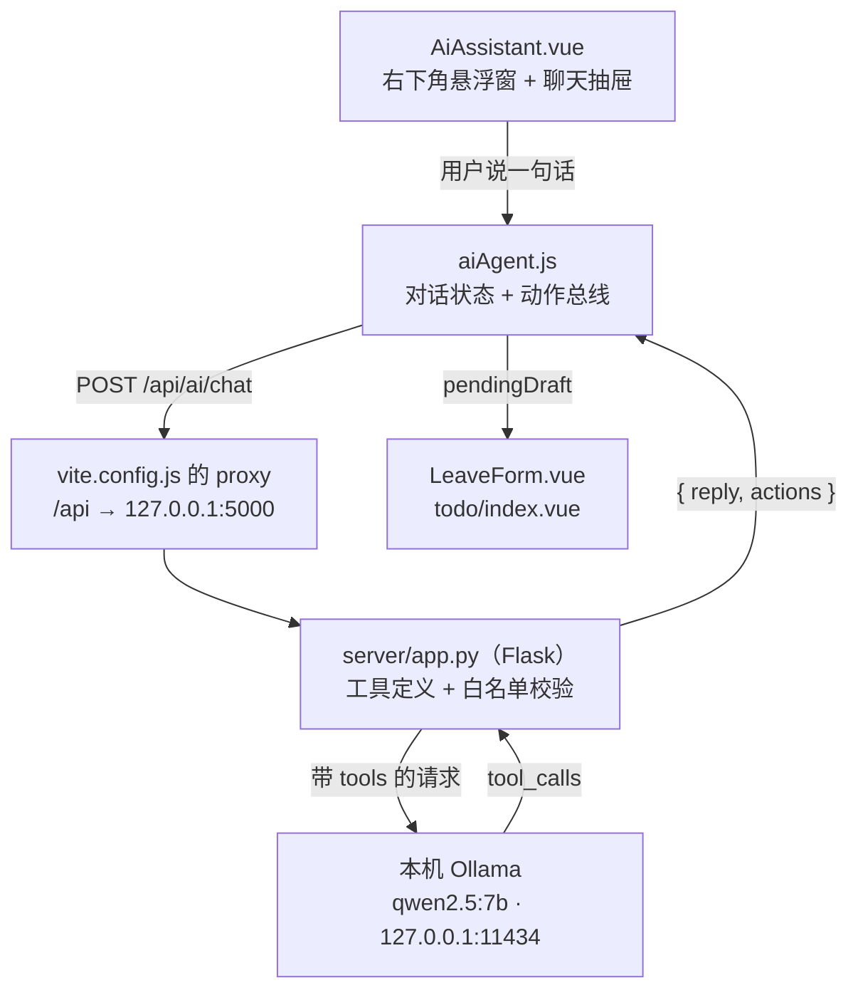

# AI 智能体接入指南

> 项目：学生工作管理系统（Vue 3 + Vite + Element Plus）
> 完成时间：2026-10-12 · 负责人：刘皖
> 一句话：**右下角一个蓝色圆按钮，说人话就能查东西、跳页面、把表单填好。**
> 模型跑在**你自己电脑上**（Ollama + qwen2.5:7b），不用联网、不用 API key、不花钱。

---

## 一、它到底是什么

### 1.1 聊天机器人和智能体的区别

| | 聊天机器人 | 智能体（本项目） |
| --- | --- | --- |
| 你说「帮我请个假」 | 回你「好的，请到请假页填写」 | 自己把表单填好，再说「填好了，你看一眼」 |
| 能力来源 | 只有一张嘴 | 一张嘴 + 一双手 |

差的这一双手，在技术上叫 **工具（tools）**。我们交给模型一张能力清单：

```
┌─────────────────────────────────────────────┐
│ go_to_page       → 跳转到指定页面            │
│ fill_leave_form  → 把请假信息填进请假表单    │
│ create_todo      → 打开新建待办弹窗并预填    │
└─────────────────────────────────────────────┘
      ↑ 模型自己决定用哪个、传什么参数
      ↓ 我们（后端代码）负责真正执行
```

### 1.2 最重要的安全底线

> **模型只出主意，动手的永远是被我们审查过的代码。**

模型**碰不到页面**。它只会返回一句「我要调用 `fill_leave_form`，参数是这些」，
真正去填表的是我们自己的 `runActions()`。所以：

- 模型不可能填错框、不可能覆盖用户刚打的内容
- 返回的字段要过**白名单**（契约里没写的字段一律丢弃）
- 日期要做**格式校验**，非法值直接扔掉
- 只填表，**永远不替用户点提交**

---

## 二、架构



| 层 | 文件 | 只干一件事 |
| --- | --- | --- |
| 界面层 | `src/components/AiAssistant.vue` | 画气泡、收输入、开关抽屉 |
| 状态层 | `src/composables/aiAgent.js` | 存对话、执行动作、最后一道兜底 |
| 接口层 | `src/api/ai.js` | 按契约发请求（换后端只改这里） |
| 代理层 | `server/app.py` | 定义工具、校验参数、跑智能体循环 |
| 页面层 | `LeaveForm.vue`、`todo/index.vue` | 接到草稿就填进表单 |

### 模型就在本机，为什么还留一个代理层？

因为它的价值早就不只是「藏 key」了：

1. **契约收口** —— 前端只认 `{ reply, actions }`。以后想换模型、甚至换成云端模型，
   只改这一层，前端一行都不用动。
2. **白名单校验** —— 模型给什么不算数，这一层逐字段检查过，才允许落到表单上。
3. **降级** —— 本机模型没启动 / 报错时，这里还能退回本地正则规则。

---

## 三、文件清单

### 3.1 新增（全部归刘皖）

| 文件 | 说明 |
| --- | --- |
| `server/app.py` | Flask 代理：工具定义、智能体循环、参数清洗、日期校正、本地规则兜底 |
| `server/requirements.txt` | Flask / requests / python-dotenv |
| `server/.env.example` | 配置模板（**会提交**） |
| `server/.env` | 本机配置（**被 gitignore，不提交**） |
| `src/api/ai.js` | 接口封装，只认契约 |
| `src/composables/aiAgent.js` | 对话状态、`pendingDraft` 动作总线、前端兜底、日期解析 |
| `src/composables/useSpeechInput.js` | 语音输入（浏览器 Web Speech API 的封装） |
| `src/components/AiAssistant.vue` | 悬浮按钮 + 聊天抽屉 |
| `.env.example`（根目录） | 线上代理地址占位（`VITE_AI_BASE_URL`） |
| `docs/AI智能体接入指南.md` | 本文件 |

### 3.2 改动

| 文件 | 改了什么 |
| --- | --- |
| `vite.config.js` | 加 `proxy: { '/api': 'http://127.0.0.1:5000' }` |
| `src/layout/BasicLayout.vue` | 挂了一个 `<AiAssistant />`（全站常驻） |
| `luoxinyu/views/leave/components/LeaveForm.vue` | +3 行 `watch(pendingDraft)` |
| `zhangjing/views/todo/index.vue` | +3 行 `watch(pendingDraft)` |

> ⚠️ **规矩提醒**：后两个文件属于队友（罗欣雨 / 张晶）。
> 按 `docs/项目框架.md` 的约定，只有她们自己能改。上线前应当在群里说一声、由她们自己加。
> 改动确实只有 3 行，但"小事所以自己动手"正是规矩最容易烂掉的地方。

---

## 四、怎么跑起来

### 4.1 三步

```powershell
# 第 1 步：装 Ollama（只需一次）
#   官网下载地址会跳 GitHub，国内直连会断。用镜像下，然后务必验签名：
#   Get-AuthenticodeSignature 应显示 Valid + CN=Ollama Inc.
#   安装时指定目录，别占 C 盘：OllamaSetup.exe /DIR="E:\ollama"

# 第 2 步：拉模型（只需一次，4.36 GB）
#   直连 registry.ollama.ai 会 Error: unexpected EOF，改从魔搭下 GGUF 再导入（见 7.1）

# 第 3 步：开两个终端
python server/app.py     # 终端 1：AI 代理
npm run dev              # 终端 2：前端
```

打开 <http://localhost:5173>，右下角出现蓝色圆按钮。

### 4.2 确认模型在跑

```powershell
ollama list                                    # 应能看到 qwen2.5:7b
Invoke-RestMethod http://127.0.0.1:5000/api/ai/health
# → {"ok":true,"providers":["本机 qwen2.5:7b"]}
```

`providers` 里没有东西 = 模型被关掉了（`OLLAMA_ENABLED=0`），此时只剩本地正则规则。

### 4.3 不需要任何 API key

这一点和大多数教程不一样：**模型跑在你自己的电脑上，没有 key 这种东西**。
不联网、不注册、不花钱，只花电费。

> 所以 `server/.env` 里**没有密钥**，它只是用来调参数的（换模型、改超时、开关模型）。

---

## 五、接口契约（前后端唯一的约定）

契约不变，换模型 / 换后端语言 / 换服务器，前端一行都不用改。

### 请求

```
POST /api/ai/chat
Content-Type: application/json

{
  "messages": [ { "role": "user", "content": "下周三到周五请病假，感冒发烧" } ],
  "page": "/leave",       // 用户当前所在页面，帮模型判断上下文
  "user": "刘皖"          // 当前显示名称
}
```

### 响应

```json
{
  "ok": true,
  "source": "ollama",                // ollama = 本机模型；local = 本地规则兜底
  "reply": "请假信息已填写，请您确认后再提交。",
  "actions": [
    { "type": "fill", "target": "leave",
      "fields": { "type": "病假", "startTime": "2026-10-21", "endTime": "2026-10-23", "reason": "感冒发烧" } }
  ]
}
```

### actions 一共就三种

| action | 含义 | 前端怎么处理 |
| --- | --- | --- |
| `{ type: 'navigate', path }` | 跳页面 | `router.push(path)` |
| `{ type: 'fill', target: 'leave', fields }` | 填请假表单 | 写进 `pendingDraft`，`LeaveForm.vue` 接住 |
| `{ type: 'fill', target: 'todo', fields }` | 预填新建待办弹窗 | 写进 `pendingDraft`，`todo/index.vue` 接住 |

### 字段白名单

**leave**：`type`（事假/病假/年假）、`startTime`、`endTime`（`YYYY-MM-DD`）、`reason`（5–200 字）

**todo**：`title`、`description`、`category`、`priority`、`assignee`、`dueDate`、`status`

> 后端 `clean_leave()` / `clean_todo()` 会**逐个字段校验**，不在白名单或格式不对的直接丢掉。
> **模型说什么不算数，代码认了才算数。**

---

## 六、怎么用

### 6.1 三种输入方式

**打字** / 点**快捷短语** / **说话**（见 6.4）

### 6.2 试用这几句

| 你说 | 预期结果 |
| --- | --- |
| `下周三到周五请病假，感冒发烧` | 抽屉自动收起，请假表单填好，等你点提交 |
| `今天到后天事假，回家办事` | 事假、今天到后天、原因「回家办事」 |
| `打开待办事项` | 跳到 `/todo` |
| `新建待办：整理周例会材料，周五截止` | 待办新建弹窗打开，标题 + 截止日期都预填 |

### 6.3 气泡下面那行小字

**`本机模型`** = 模型答的，**`本地规则`** = 死规则答的。

### 6.4 语音输入

点输入框左下角的「🎤 语音」就开始说话，再点一下停止。

| 步骤 | 界面表现 |
| --- | --- |
| 点「语音」 | 按钮变红「停止」、麦克风图标呼吸闪烁、输入框提示变「正在听……」 |
| 说话时 | 文字**实时**出现在输入框（会先出现临时结果，还在变） |
| 点「停止」 | 按钮变回「语音」 |
| 点「发送」 | 和其它输入方式完全一样 |

**⚠️ 三条必须知道的限制（答辩时别讲错）：**

| 限制 | 说明 |
| --- | --- |
| **只有 Chrome / Edge 有** | Firefox 至今没实现这个 API。不支持时按钮自动置灰，鼠标悬停有提示 |
| **必须联网** | 它**不是本机识别**——音频会发到浏览器厂商的服务器（Edge→微软，Chrome→Google）。所以它和「模型跑在本机、数据不出机器」是**两回事** |
| 没权限会失败 | 会弹提示「点地址栏左边的锁图标，把麦克风改成允许」 |

想做到**真正离线**的语音识别，得另接本地 Whisper（下模型 + 写服务），那是另一套东西。
取舍说明写在 `src/composables/useSpeechInput.js` 顶部。

**设计上刻意没做的事**：识别完**不会自动发送**——文字先落到输入框，你看一眼、改一改，
再自己点发送。跟「AI 只代笔、不代签」是同一条原则。

---

## 七、降级：模型挂了也不哑火

```
用户发一句话
   ↓
① 本机 Ollama（qwen2.5:7b）  → source: "ollama"  气泡下标「本机模型」
   ↓ 没启动 / 超时 / 报 500 / 参数残缺
② 后端本地正则规则            → source: "local"   下标记「本地规则」
   ↓ 后端整个没启动（连 Flask 都没跑）
③ 前端 aiAgent.js 再兜一层
```

每一层往下走都会在服务端打印一行 `[降级] xxx 用不了 → 原因`，排查时看终端就行。

**⚠️ 两个排查经验（都踩过）：**

1. **别用 `raise_for_status()`。** 它只给你一个干巴巴的 `500 Server Error`，服务端到底为什么
   拒绝完全看不到。实测时就是卡在这一步，改成把响应正文带出来之后，
   才一眼看到真正的原因是 `invalid tool call arguments: unexpected end of JSON input`。
2. **降级的原因要带出来。** `server/app.py` 会把失败原因塞进响应的 `error` 字段，
   前端虽然不显示，但抓一次请求就能看到全部。

**本地规则认什么：** `今天/明天/后天/大后天`、`周X`、`下周X`、`本周X`、`X月X日`、`X到Y`、
`三天/2天`、`2026-11-03`。认不出来就老实说「我没听出是哪几天」，**不猜、不编**。

### 7.1 本机模型（Ollama）怎么装的

| 项 | 值 |
| --- | --- |
| 程序位置 | `E:\ollama`（安装时加 `/DIR="E:\ollama"`，不占 C 盘） |
| 模型文件 | `E:\ollama\models`（4.36 GB） |
| 模型 | `qwen2.5:7b`（Q4_K_M，7.6B，`Capabilities: tools`） |
| 显卡 | RTX 5060 Laptop 8GB，`ollama ps` 显示 `100% GPU` |

**踩到的三个坑：**

1. **官方下载地址跳 GitHub，国内直连会断。** `ollama.com/download/OllamaSetup.exe` 会 307 跳到
   GitHub Releases，实测直连不通。走镜像 `gh-proxy.com` 才下得动。
   ⚠️ 走镜像**一定要验数字签名**（`Get-AuthenticodeSignature`，应显示 `Valid` + `Ollama Inc.`），
   否则等于在陌生网站装了个 exe。
2. **`ollama pull` 会 `Error: unexpected EOF`。** 直连 `registry.ollama.ai` 大约 2.7 MB/s，还断流。
   正解是从**魔搭 ModelScope** 下单文件 GGUF，再用 `ollama create` 导入（单文件！官方仓库的
   `-00001-of-00002` 分片版对 Ollama 不友好）：

   ```powershell
   # 下载（单文件版在 bartowski / second-state 这两个仓库里）
   curl.exe -L -o E:\ollama\gguf\model.gguf `
     "https://modelscope.cn/models/bartowski/Qwen2.5-7B-Instruct-GGUF/resolve/master/Qwen2.5-7B-Instruct-Q4_K_M.gguf"

   # Modelfile 里只写 FROM + PARAMETER，⚠️ 不要写 SYSTEM（会和后端下发的 system 打架）
   # FROM ./Qwen2.5-7B-Instruct-Q4_K_M.gguf

   cd E:\ollama\gguf; ollama create qwen2.5:7b -f Modelfile
   ```
3. **`OLLAMA_MODELS` 环境变量对 Windows 那个托盘程序不生效。** 模型还是落在了
   `C:\Users\<你>\.ollama\models`。Windows 版把配置放在内部数据库里，不是注册表也不是
   `config.json`。最后一个能用的解法是**目录联接**：

   ```powershell
   # 停掉 ollama → 把模型搬到 E 盘 → 在原位置建一个「传送门」
   New-Item -ItemType Junction -Path "$env:USERPROFILE\.ollama\models" -Target 'E:\ollama\models'
   ```

**本机模型的能力边界（实测，别抱幻想）：**

| 能做 | 做不好 |
| --- | --- |
| 听懂人话、判断请假类型、提炼原因 | **算日期**（「下周三」算成 10-18、10-19） |
| 调用工具（`Capabilities: tools` ✔） | 信息模糊时容易「硬填」而不是反问 |
| 热启动 1~2 秒、约 50 tok/s | 冷启动要从硬盘读 4.4 GB，第一次可能等 1~3 分钟 |

### 7.2 关键设计：日期不由模型算

因为小模型算日期不靠谱，而且**给它对照表也没用**（实测给了 ISO 对照表还是算成 10-19），
最后改成让**确定性的代码**管日期：

```
【模型管】听懂人话、判断类型、提炼原因
【代码管】算日期 —— resolve_dates() 是确定性的、有测试覆盖的
```

`server/app.py` 里的 `reconcile_dates()` 会在模型返回之后，用我们自己的解析结果
把日期**校正一遍**；我们解析不出来时才用模型的值（这样不会覆盖「模型故意不填」的情况）。

> 这条经验可以带到任何地方：**模型擅长模糊判断，不擅长精确计算。
> 能交给代码的精确活，就别交给模型。**

---

## 八、怎么加一个新工具（重点教学）

假设要让它能「把某条公告标记为已读」。只改**两处**：

### ① 后端：加一张工具说明书（`server/app.py`）

```python
# 1) 在 TOOLS 列表里加一项，告诉模型有这个能力
{
    "type": "function",
    "function": {
        "name": "mark_notice_read",
        "description": "把某条公告标记为已读",
        "parameters": {
            "type": "object",
            "properties": { "id": { "type": "integer", "description": "公告编号" } },
            "required": ["id"],
        },
    },
},
```

```python
# 2) 在 action_from_tool() 里加一个分支，把参数翻成前端认识的动作
if name == "mark_notice_read":
    return {"type": "read", "id": args.get("id")}
```

### ② 前端：让页面能接住这个动作

```js
// aiAgent.js 的 runActions() 加一个分支
} else if (action.type === 'read' && action.id) {
  pendingNoticeId.value = action.id
}
```

```js
// 公告页里照抄 LeaveForm.vue 那段 watch
watch(pendingDraft, () => {
  const fields = consumeDraft('notice')
  if (!fields) return
  // 把 fields 应用到页面状态
}, { immediate: true })
```

**完事。** 前端不需要知道背后是什么模型，后端也不需要知道前端是 Vue 还是 React。

---

## 九、实测记录（可直接写进作业 / 答辩材料）

环境：Windows · Node 24.19.0 · Vue 3.5.43 · Vite 8.3.2 · Element Plus 2.14.7 ·
Python 3.12.7 · Flask 3.1.3 · Ollama 0.40.3 · qwen2.5:7b Q4_K_M

| 用例 | 结果 | 耗时 |
| --- | --- | --- |
| `health` 接口 | `providers: ["本机 qwen2.5:7b"]` | — |
| 下周三到周五请病假，感冒发烧 | 病假 / `2026-10-21` / `2026-10-23` / 原因「感冒发烧」，页面自动算出**合计天数 3 天**，抽屉自动收起 | 2.5s |
| 今天到后天事假，回家办事 | 事假 / `2026-10-12` / `2026-10-14` / 原因「回家办事」 | 1.9s |
| 2026-11-03 到 2026-11-05 年假，参加校外比赛 | 年假 / `2026-11-03` / `2026-11-05` / 原因「参加校外比赛」 | 1.9s |
| 打开待办事项 | 跳转 `/todo`（`navigate`） | 1.4s |
| 新建待办：整理周例会材料，周五截止 | 待办弹窗打开，标题「整理周例会材料」+ 截止 `2026-10-16` | 1.6s |
| 这周五下午我可能起不来床，帮我请个假 | 病假 / `2026-10-16`（**它直接填了，不会反问**） | 1.9s |
| 6 条用例合计 | **0 个 500、0 个超时** | 均 < 2.5s |
| 前端控制台 | 0 报错 | — |
| `npm run build` | 通过 | — |

**已知短板**：信息模糊时（如最后一条），7B 模型会**硬填**而不是反问。
这是能力差异，不是 bug——要更聪明的表现，得换更大的模型。
本地规则那条路也一样：`下周三到周五请病假` → `10-21 ~ 10-23`，
`本周一到周五事假` → `10-12 ~ 10-16`，全部正确。

---

## 十、踩过的坑（都是真事）

### 坑 1：`el-drawer` 的开关不能放在跨模块共享的 ref 上 🔴

**最初写法**：把 `export const agentOpen = ref(false)` 放在 `aiAgent.js`，组件里 `v-model="agentOpen"`。

**症状**：抽屉**能开不能关**——点 X 关不掉、按 Esc 关不掉、点遮罩关不掉、代码里写
`agentOpen.value = false` 也关不掉。四条路全死。

**更迷惑的地方**：进组件内部读 `setupState.agentOpen` 明明是 `false`，抽屉却开着；
手动 `setupState.agentOpen = false` 也没反应。改成显式的 `:model-value` + `@update:model-value`
**一样没用**。

**原因**：编译产出的是 `"onUpdate:modelValue": $event => (($setup.agentOpen) = $event)`——
这个写回到不了模块里真正的那个 ref。

**解法**：抽屉开关用**组件自己的 ref**（`const drawerVisible = ref(false)` + `v-model="drawerVisible"`），
composable 想收起抽屉就走回调：

```js
// aiAgent.js
let closeHandler = null
export function onAgentCloseRequest(fn) { closeHandler = fn }
function requestAgentClose() { if (closeHandler) closeHandler() }

// AiAssistant.vue
const drawerVisible = ref(false)
onAgentCloseRequest(() => { drawerVisible.value = false })
```

> 💡 **可靠的抽屉开合探针**（比截图、比"DOM 里有没有"都准）：
> ```js
> const r = document.querySelector('.el-drawer').getBoundingClientRect()
> r.width + 'x' + r.height   // "0x0" = 关着；"380x5xx" = 开着
> ```

### 坑 2：「下周三到周五」被算成了同一天

**症状**：填出来是 `10-21 ~ 10-21`。

**原因**：裸「周五」被解释成**本周五(10-16)**，而「下周三」是**下周三(10-21)**——
结束比开始早，触发了「结束早于开始」的防呆逻辑，被压平成同一天。

**人话**：说「下周三到周五」时，那个「周五」指的是**下周五**，不是这周五。

**解法**：`resolve_dates()` 里维护一个"最近提到的周"上下文，裸「周X」跟在「下周X / 本周X」
后面时算**同一周**。前端 `aiAgent.js` 的 `findDates()` 有一份同款逻辑，必须同步改。

### 坑 3：给模型「日期对照表」并不能治好它算日期 🔴

实测 qwen2.5:7b：

| 给的提示 | 它填的下周三 |
| --- | --- |
| 只告诉它「今天是 2026-10-12 星期一」 | `2026-10-18` ❌ |
| 再给一张「10月21日」的对照表 | `2026-10-19` ❌ |
| 改成 ISO 格式的 `2026-10-21`，让它照抄 | `2026-10-19` ❌ |
| **最后：日期不由它算，用代码校正** | `2026-10-21` ✅ |

三次引导都失败，说明这**不是提示词能解决的问题**。
**结论：精确计算类的事，换实现而不是换提示词。**

### 坑 4：`max_tokens` 两头都是坑 🟡

小模型调工具前爱先写一段废话，把输出额度吃光。实测：

| 设置 | 后果 |
| --- | --- |
| 不设上限 | 模型复读，把 300 秒超时跑满 |
| `max_tokens=400` | 工具参数的 JSON 被截断，Ollama 回 **500**：`invalid tool call arguments: unexpected end of JSON input` |
| **`max_tokens=1536`** | ✅ 实测 6/6 通过 |

再配一条提示词「调工具前不要先写解释」，基本就稳了。

### 坑 5：system 提示里的「示例词」会被小模型抄进答案 🔴

我原本在提示词里写：「用户说『感冒发烧』，就只写『感冒发烧』」。
结果用户输入「今天到后天事假，回家办事」，模型答：**「请确认请假原因：感冒发烧？」**——
把我提示词里的例子当成用户说的话了。

**教训：提示词里要用示例，就用和真实业务数据完全不相干的词**，或者干脆不举例。

### 坑 6：别用 `raise_for_status()`

它只给你一个 `500 Server Error`，服务端为什么拒绝完全看不到。
改成把响应正文带出来，才一眼看到真因。**排查能力比代码优雅重要。**

---

## 十一、上线（阿里云）

因为模型跑在本机，上线要分清楚「谁的机器跑模型」：

| 方案 | 说明 |
| --- | --- |
| **A. 模型留在本机（推荐给答辩）** | 服务器上只跑前端。演示时模型在你笔记本上跑，**不用交 GPU 租金** |
| B. 模型上服务器 | 得买带 GPU 的实例，贵；或者用 CPU 跑，会很慢 |

A 方案的具体做法：

1. 把 `server/` 和前端都传上服务器
2. `gunicorn` 或 `nohup python app.py &` 起 Flask（别用自带的 `app.run()`）
3. Nginx 加一段把 `/api` 转发到 Flask 的 5000 端口
4. ⚠️ 服务器上**没有 Ollama**，所以线上只会走「本地正则规则」那条路。
   要么给服务器也装 Ollama，要么接受降级

---

## 十二、答辩可以讲的五个点

1. **智能体和聊天机器人差在哪** —— 差在「有没有工具」，我们给了它三个。
2. **为什么不让 AI 直接操作界面** —— 它可能填错框、覆盖用户输入；输出结构化 JSON 才能被代码校验，
   **模型只出主意，动手的是被审查过的代码**。
3. **为什么日期不由模型算** —— 实测三次提示词引导全部失败，最后改成代码校正。
   讲这条最有说服力，因为它证明你是**测出来的**，不是拍脑袋。
4. **为什么断开模型也还能用** —— 三层降级，现场拔网线都不哑火。
5. **为什么模型跑在本机** —— 不花钱、不联网、数据不出机器；对实验室里处理敏感数据的场景，
   这一条尤其关键。

---

## 附：给队友的一句话交接

> 右下角那个蓝色圆按钮是 AI 助手，说人话就能填表。
> 想让你的页面也能被 AI 填，照 `luoxinyu/views/leave/components/LeaveForm.vue` 里那段
> `watch(pendingDraft, ...)` 抄 3 行就行。
> 启动 AI 代理：`python server/app.py`（模型跑在本机 Ollama 上，不需要 key）。
