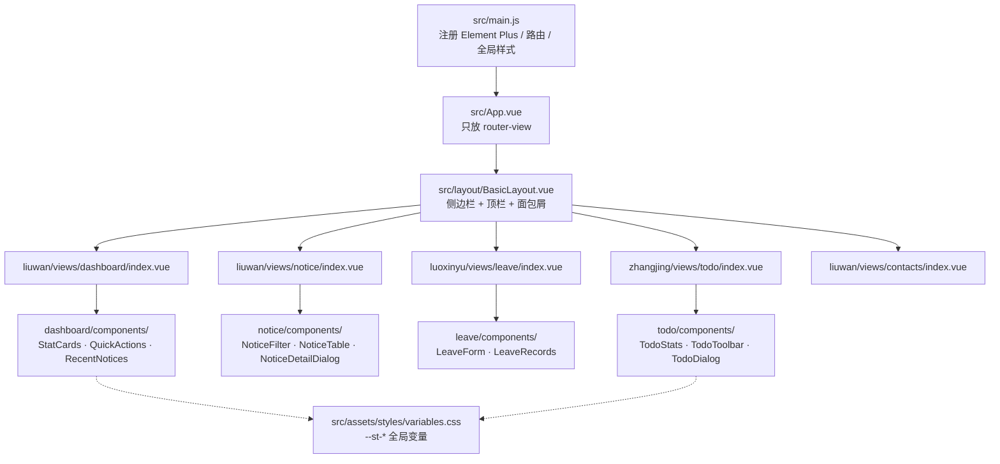

# 项目框架说明

> 写给刘皖（技术规范 + 仓库管理）。
> 这份文档回答一个问题：**三个人同时在改一个仓库，凭什么不会互相打架？**

---

## 一、一句话架构

```
浏览器输入 /leave
   ↓  Vue Router 按路由表匹配
   ↓  BasicLayout 渲染外壳（侧边栏 + 顶栏 + 面包屑）
   ↓  <router-view> 塞进 views/leave/index.vue
   ↓  页面从统一 appStore 读取业务数据
   ↓  appStore 通过 Flask API 与 SQLite 同步
```

**两个决定性的设计：**

1. **`BasicLayout` 只写一次。** 侧边栏、顶栏、面包屑、菜单高亮全部在这里，队友的页面只管「内容区」，不需要碰导航。所以队友改页面永远不会改坏别人的导航栏。
2. **路由表集中在一个文件。** `src/router/index.js` 由你独占维护，队友不碰。这是全组唯一会「被三个人同时改」的文件，把它锁死，冲突就少了最大的一块。

---

## 二、目录职责表

| 目录 / 文件 | 谁负责 | 其他人能不能改 |
| --- | --- | --- |
| `src/main.js` / `src/App.vue` | 刘皖 | ❌ 不能 |
| `src/router/index.js` | 刘皖 | ❌ 不能 |
| `src/layout/BasicLayout.vue` | 刘皖 | ❌ 不能 |
| `src/assets/styles/variables.css` | 刘皖 | ⚠️ 只能提需求，不能自己加 |
| `src/mock/index.js` | 刘皖 | ⚠️ **所有人都要读它**，改数据前先在群里说一声 |
| `src/composables/aiAgent.js`<br>`src/composables/useSpeechInput.js`<br>`src/composables/notifications.js`<br>`src/composables/permissions.js`<br>`src/composables/uiSettings.js`<br>`src/api/` | 刘皖 | ⚠️ 只能提需求 |
| `src/composables/userProfile.js` | 张晶（她建的） | ⚠️ 全站共用，改之前先说 |
| `liuwan/views/dashboard/` | 刘皖 | ❌ 不能 |
| `liuwan/views/notice/` | 刘皖 | ❌ 不能 |
| `liuwan/views/assistant/` | 刘皖 | ❌ 不能 |
| `liuwan/views/contacts/` | 刘皖 | ❌ 不能 |
| `luoxinyu/views/leave/` | 罗欣雨 | ✅ 只有她能改 |
| `zhangjing/views/todo/` | 张晶 | ✅ 只有她能改 |
| `server/`（Flask AI 代理） | 刘皖 | ⚠️ 只能提需求 |
| `vite.config.js` / `package.json` | 刘皖 | ❌ 不能 |

**核心规则：一个人 = 一个根目录文件夹 = 一行路由。**
成员目录里的 `index.vue` 只做「组装」，表格 / 表单 / 弹窗放到同级的 `components/` 里。
文件夹是私有的，路由行是共有的但由你代填。

> `src/` 里放的是三个页面共用的外壳（入口、路由、布局、全局样式、共享状态），
> 不属于任何一个人。

### ⚠️ 两条已经踩过的线

1. **假数据别在自己页面里再抄一份。**
   统一写在 `src/mock/index.js`，数字从它算出来。
   之前首页写死「公告 3 条」、公告页实际 12 条，首页「最新公告」还把同一个活动
   写成另一个日期 —— 就是因为各处各写一份。
2. **`src/composables/userProfile.js` 是全站共享状态**（当前用户名 + 角色）。
   它现在实际上是张晶建的，但改它会影响三个页面，动手前先打个招呼。

---

## 三、分层结构



**每个页面都是「两字结构」：**

| 文件 | 职责 |
| --- | --- |
| `index.vue` | 只做组装：拿数据、管状态、把子组件拼起来 |
| `components/*.vue` | 具体的一块界面（表格 / 表单 / 弹窗），通过 props + emit 和父级通信 |

**样式是自上而下单向覆盖的：**

```
element-plus/dist/index.css   ← 组件库默认样式
        ↓ 被覆盖
variables.css                 ← 你的 --st-* 变量
        ↓ 被覆盖
页面自己的 <style scoped>      ← 只影响自己那个页面
```

所以 `main.js` 里这两个 import 的顺序不能调换：

```js
import 'element-plus/dist/index.css' // 必须在前
import '@/assets/styles/variables.css' // 必须在后
```

---

## 四、数据流

| 阶段 | 数据从哪来 | 要改哪里 |
| --- | --- | --- |
| 页面状态 | `src/composables/appStore.js` | 所有页面、通知、AI 共用 |
| 持久化 | Flask `/api/workspace` | `src/api/workspace.js` |
| 数据库 | `server/student_work.db`（SQLite） | 首次启动自动建表、写入种子数据，并迁移已有浏览器缓存 |
| 通讯录 | `src/mock/index.js` | `DIRECTORY_CONTACTS` 为通讯录演示数据，页面支持姓名/部门搜索与部门筛选 |

启动前端前先运行 `python server\app.py`；Vite 将 `/api` 代理到本机 Flask 服务。首次启动优先将已有浏览器缓存迁入数据库，之后以 SQLite 为权威数据源；变更会自动写回 SQLite，`localStorage` 只作数据库不可用时的本地缓存。
当前演示版没有用户登录认证；局域网内能访问前端的设备也能读写数据库，请勿暴露到公网或不可信网络。

---

## 五、三条铁律（防止冲突）

1. **不碰别人的文件夹。** 需要改别人的页面，先在群里说，让对方改。
2. **不碰 `router/index.js`。** 你的路由行已经配好了，不需要动。真要加页面，找刘皖加。
3. **颜色只用变量。** 想用一个变量表里没有的颜色，找刘皖加到 `variables.css`，不要自己写 `#xxxxxx`。

---

## 六、你（刘皖）要守住的事

- ✅ `main` 分支永远能跑起来。每次合并 PR 前先 `npm run build`，报错就打回去。
- ✅ 队友的 PR 只允许改动「她自己那个文件夹」。如果 PR 里出现了 `router/index.js`、`main.js`、别人的页面 → 打回去重做。
- ✅ 合并前检查页面上「工作台 → 公告 → 请假 → 待办」四个菜单能不能互相跳转、返回会不会白屏。
- ✅ 队友说「我要加一个新页面」时，由你改 `router/index.js` + 给菜单加一行，不要让她自己加。

---

## 七、当前进度快照

| 模块 | 状态 | 位置 |
| --- | --- | --- |
| 项目初始化 / 依赖 | ✅ 完成 | `package.json` |
| 整体布局 + 路由 | ✅ 完成 | `src/layout/`、`src/router/` |
| 全局样式变量 + 代码规范 | ✅ 完成 | `src/assets/styles/`、`.prettierrc.json` |
| 工作台首页 | ✅ 完成 | `liuwan/views/dashboard/` |
| 公告通知页 | ✅ 完成 | `liuwan/views/notice/` |
| 通讯录（搜索 + 部门筛选） | ✅ 完成 | `liuwan/views/contacts/` |
| 请假申请页 | ✅ 完成 | `luoxinyu/views/leave/` |
| 待办事项页 | ✅ 完成 | `zhangjing/views/todo/` |
| 自定义显示名称 + 角色切换 | ✅ 完成 | `src/composables/userProfile.js`（张晶） |
| 页面拆分子组件 | ✅ 完成 | 各成员目录下的 `components/` |
| AI 助手（悬浮窗 + 独立页 + 语音 + 工具调用） | ✅ 完成 | `src/components/`、`src/composables/aiAgent.js`、`server/` |
| 工作台每日打卡（含地理位置 + 地名） | ✅ 完成 | `liuwan/views/dashboard/components/CheckIn.vue` |
| 顶栏通知中心 | ✅ 完成 | `src/composables/notifications.js` |
| 侧边栏底部账号入口（我的 / 设置 / 退出账户） | ✅ 完成 | `src/layout/BasicLayout.vue` + `src/composables/uiSettings.js` |
| 假数据统一到 `src/mock/` | ✅ 完成 | `src/mock/index.js` |
| 页面截图 | ✅ 完成 | `docs/screenshots/` |
| 权限（只做了按钮显示，真正拦截靠后端） | 🟡 部分 | `src/composables/permissions.js` |
| Flask + SQLite 业务接口 | ✅ 完成 | `server/app.py`、`src/api/workspace.js` |
| 把假数据换成数据库 | ⬜ 未开始 | `src/mock/` + `server/mock_data.py` 一起换 |
